# Technical Architecture & Engineering Manual — 49ers Faithful (`49ers.joshal.com`)

| Document Metadata | Details |
| :--- | :--- |
| **Platform Name** | **49ers Faithful** (`49ers Faithful Briefing`) |
| **Production Domain** | `https://49ers.joshal.com` (`CNAME` → `joshal7.github.io`) |
| **Target Runtime** | iPhone 16 / 16 Pro iOS Safari Standalone PWA (`49ers HQ`) & Mobile/Desktop Chrome |
| **Operating Cost** | **\$0/month** (GitHub Pages + GitHub Actions + Cloudflare Free Tier + Google AI Studio Free Tier) |
| **Test Coverage** | `npm test` → `tests/unit-engines-qa.mjs` (Unit/Math/Data/Worker) + `tests/e2e-mobile-qa.mjs` (Headless Chrome CDP Mobile E2E) |

---

## 1. Holistic System Overview

**49ers Faithful (`49ers.joshal.com`)** is a zero-cost, mobile-first Progressive Web App engineered for ~25 analytically minded San Francisco 49ers fans. It combines deterministic client-side quantitative engines (5-year CBA salary cap simulation, player-specific injury play-probability modeling, 10,000-run Empirical-Bayes playoff Monte Carlo, and anti-fluff news clustering) with live client telemetry (ESPN + Bluesky AT Protocol + podcast RSS) and accuracy-first generative AI synthesis (Gemini `3.8-flash` / `3.8-pro` on `HIGH` Thinking + Studio Multi-Speaker Neural Audio).

```mermaid
flowchart TD
    subgraph Client["iPhone 16 Safari / Chrome PWA (Zero External Runtime Deps)"]
        App["src/app.js (State & Event Controller)"]
        Views["src/views/* (5 Bottom Tabs, Two-Cluster Season Nav, 5-Tab Player Sheet)"]
        Engines["src/engine/* (10 Deterministic Quantitative & Guardrail Engines)"]
        Audio["src/components/audioPlayer.js (MediaSession + iOS Stereo Playback Carrier)"]
        SW["sw.js (CacheStorage v14 Offline-First Shell & Audio Range Bypass)"]
    end

    subgraph DataLayer["Static & Live Hydration Layer (src/services/dataService.js)"]
        StaticJSON["/data/*.json (11 Pre-Compiled Verified Feeds + 3 Studio .m4a Pods)"]
        LiveWire["Sub-Minute Client Overlay (ESPN API + Bluesky XRPC + iTunes/RSS)"]
    end

    subgraph Edge["Optional $0/mo Cloudflare Serverless Edge (worker/index.js)"]
        Worker["Worker API (X-Group-Passcode Auth + 6h Model Auto-Upgrade Cron)"]
        KV["Cloudflare KV (SHARED_CACHE: Deduplicated Reports, Episode Index & Model Catalog)"]
        R2["Cloudflare R2 (PODCAST_BUCKET: 2-Ch Stereo WAV / Audio Streams)"]
        Gemini["Google Gemini Free Tier (3.8-flash HIGH Thinking 2-Pass Audit + Pro/Flash TTS)"]
    end

    subgraph Pipeline["Scheduled Ingestion & Studio Audio Pipeline (scripts/)"]
        Ingest["scripts/fetch-live-49ers-data.mjs (ESPN + nflverse + OTC + 49ers.com + CBS + Tankathon)"]
        PodBuild["scripts/build-podcasts.mjs (Edge-TTS Neural Voices + 44.1kHz Broadcast DSP -> .m4a)"]
        Reporters["scripts/update-reporter-registry.mjs (45-Source Credibility & Velocity Ranker)"]
    end

    Ingest -->|"Writes Verified JSON"| StaticJSON
    PodBuild -->|"Encodes 96kbps AAC"| StaticJSON
    Reporters -->|"Updates data/reporters.json"| StaticJSON

    App --> Views
    App --> Engines
    App --> Audio
    App --> StaticJSON
    App -->|"20s In-Game / 45s Standard Poll"| LiveWire
    App -->|"POST /api/analyze & /api/podcast"| Worker
    Worker <--> KV
    Worker <--> R2
    Worker -->|"thinkingBudget=24576 + Search Grounding"| Gemini
```

---

## 2. Core Engineering Philosophy: Quality vs. Speed Decision Matrix

A foundational design principle of this codebase is knowing **when to push uncompromisingly for analytical accuracy and studio quality over latency** versus **when to enforce sub-second / sub-minute speed**. Future changes must preserve this dichotomy:

| Subsystem / Workflow | Priority Mode | Target Latency | Architectural Rationale & Enforcement Mechanism |
| :--- | :--- | :--- | :--- |
| **On-Demand AI Deep Analysis (`/api/analyze`)** | **Accuracy & Depth Over Speed** (`accuracy_over_latency`) | `~20–40 sec` (Cloud) / `~2–3 sec` (Local fallback) | Readers gladly wait 30 seconds for coaching-tape-grade X's & O's and exact CBA cap math rather than receiving a fast, shallow, or hallucinated summary. Uses `gemini-3.8-flash` (or `gemini-3.8-pro` when available) with `thinkingBudget: 24576` (`HIGH`), live Google Search Grounding, and a **2-pass internal verification audit** (`verifyPass: true`). |
| **On-Demand & Pre-Built Autopodcasts (`/api/podcast`, `build-podcasts.mjs`)** | **Audio Realism & Fact Rigor Over Speed** | `~30–130 sec` (scaled by `2–20 min` duration) | Listeners expect natural human prosody, spoken football notation (`humanizeNflTextForTts`), zero retired-player hallucinations, and broadcast-level loudness leveling. Uses 2-pass script verification + `gemini-2.5-pro-preview-tts` → `gemini-2.5-flash-preview-tts` cascade (or 44.1 kHz 7-stage DSP mastering with `edge-tts` Multilingual Neural voices). |
| **Shared Friend-Group Cache Hits (`/api/shared-feed`, KV/R2)** | **Instant Shared Read** | `< 50 ms` | Once one user pays the 30–90s High-Thinking generation wait, the resulting report or stereo audio episode is cached in Cloudflare KV/R2 keyed by `sha256(prompt + liveContextHash)` so the other ~24 friends read/stream it instantaneously. |
| **App Startup & Navigation (`sw.js`, `src/app.js`)** | **Instant Boot & Zero Layout Shift** | `< 300 ms` first paint; `< 16 ms` tab switch | Pre-compiled `/data/*.json` feeds load immediately from Service Worker `CacheStorage` (`49ers-faithful-v14`) before background live overlays run. |
| **Live Breaking & In-Game Injury Wire (`dataService.js`, `breakingClassifier.js`)** | **Sub-Minute Real-Time Freshness** | **20s poll** (Live 49ers Game Window) / **45s poll** (Standard) | During games, blue-medical-tent and `questionable/out to return` updates from beat writers on Bluesky (`mattmaiocco.bsky.social`, `mattbarrows.bsky.social`, etc.) must surface at `#1` in `<1 minute` without waiting for a GitHub Action run. |
| **Quantitative Simulators (`capSimulator.js`, `playoffMonteCarlo.js`)** | **Synchronous Client Determinism** | `< 5 ms` (Cap Sim) / `< 150 ms` (10k Monte Carlo) | Toggling an Armchair GM contract action across `2026–2030` or tapping an NFC Rooting Guide game winner must recalculate in-memory with zero network round-trips. |

### UX Transparency for High-Thinking Jobs
Whenever a user triggers an accuracy-first AI or audio job in [`src/views/audioAiView.js`](file:///Users/joshal/workspace/49ers/src/views/audioAiView.js):
1. **Pre-Click Wait Preview (`[data-est-wait-preview]`)**: Displays rough expected duration scaled to task complexity (e.g., `Rough time (8m pod): ~46–78 sec • gemini-3.8-flash • HIGH`) via [`estimateGenerationWait`](file:///Users/joshal/workspace/49ers/src/services/aiWorkerClient.js#L36-L86).
2. **Active Processing Banner (`[data-job-progress="active"]`)**: Renders a visible dual-ring spinner (`.job-spinner-ring`), 4-bar animated audio equalizer (`.job-wave-bars`), progress bar fill (`.job-progress-fill`), live ticking elapsed timer (`#jobElapsedClock`), and an explicit `"Accuracy prioritized over speed • Gemini 3.8 High"` badge while disabling the submit button.

---

## 3. Repository & Module Map

### 3.1 Client Application & Quantitative Engines (`src/`)

| File Path | Primary Exports & Responsibilities |
| :--- | :--- |
| [`src/app.js`](file:///Users/joshal/workspace/49ers/src/app.js) | Root state container, event delegation controller, sub-minute live wire polling loop (`20s` game window / `45s` standard), HTML5 drag-and-drop + button card reordering, jargon popover positioning, and `window.__49ersDiagnostics` test hook. |
| [`src/styles.css`](file:///Users/joshal/workspace/49ers/src/styles.css) | `"Levi's Night Game"` dark theme (`#0B0D10` obsidian, `#AA0000` scarlet, `#B3995D` gold) and `"'94 Throwback"` light theme (`#F7F5F0`), `tabular-nums` alignment, responsive portrait/landscape table rules, and iOS Safe Area insets. |
| [`src/engine/seasonStateMachine.js`](file:///Users/joshal/workspace/49ers/src/engine/seasonStateMachine.js) | [`evaluateSeasonState`](file:///Users/joshal/workspace/49ers/src/engine/seasonStateMachine.js), [`resolveOrderedDashboardBlocks`](file:///Users/joshal/workspace/49ers/src/engine/seasonStateMachine.js), [`partitionCompletedTradesByWindow`](file:///Users/joshal/workspace/49ers/src/engine/seasonStateMachine.js). Manages the 6 NFL calendar phases, 12 dashboard blocks, and 30-day trade recency partitioning. |
| [`src/engine/capSimulator.js`](file:///Users/joshal/workspace/49ers/src/engine/capSimulator.js) | [`simulateCapScenario`](file:///Users/joshal/workspace/49ers/src/engine/capSimulator.js), [`formatDollars`](file:///Users/joshal/workspace/49ers/src/engine/capSimulator.js), [`formatCompactDollars`](file:///Users/joshal/workspace/49ers/src/engine/capSimulator.js). 5-year (`2026–2030`) OverTheCap CBA calculator supporting Pre/Post-June 1 Cuts & Trades, Simple Restructures, and Extensions. |
| [`src/engine/injuryProbabilityModel.js`](file:///Users/joshal/workspace/49ers/src/engine/injuryProbabilityModel.js) | [`computePlayerPlayProbability`](file:///Users/joshal/workspace/49ers/src/engine/injuryProbabilityModel.js), [`calculateIrReturnTimeline`](file:///Users/joshal/workspace/49ers/src/engine/injuryProbabilityModel.js), [`classifyIrAndReserveTimeline`](file:///Users/joshal/workspace/49ers/src/engine/injuryProbabilityModel.js), [`parseFlexibleIsoMs`](file:///Users/joshal/workspace/49ers/src/engine/injuryProbabilityModel.js). Models player-specific play odds, veteran rest vs. acute injuries, Bye-week-aware 4-game IR timelines, and Season-Ending IR vs. open 21-day practice windows. |
| [`src/engine/playoffMonteCarlo.js`](file:///Users/joshal/workspace/49ers/src/engine/playoffMonteCarlo.js) | [`runPlayoffMonteCarlo`](file:///Users/joshal/workspace/49ers/src/engine/playoffMonteCarlo.js), [`computeCalibratedTeamPowerRating`](file:///Users/joshal/workspace/49ers/src/engine/playoffMonteCarlo.js), [`computeRootingGuideLeverage`](file:///Users/joshal/workspace/49ers/src/engine/playoffMonteCarlo.js). Deterministic 10,000-run NFC seeding simulator with Empirical-Bayes shrinkage and full NFL tiebreakers. |
| [`src/engine/antiFluffFilter.js`](file:///Users/joshal/workspace/49ers/src/engine/antiFluffFilter.js) | [`scoreContentSignal`](file:///Users/joshal/workspace/49ers/src/engine/antiFluffFilter.js), [`cleanSensationalistText`](file:///Users/joshal/workspace/49ers/src/engine/antiFluffFilter.js), [`filterNewsByUserPrefs`](file:///Users/joshal/workspace/49ers/src/engine/antiFluffFilter.js). Flags clickbait/rage-bait, scores tactical signal (`0–100`), and filters feeds by user-muted outlets/reporters. |
| [`src/engine/groundingValidator.js`](file:///Users/joshal/workspace/49ers/src/engine/groundingValidator.js) | [`validateNoHallucinatedRosterClaims`](file:///Users/joshal/workspace/49ers/src/engine/groundingValidator.js), [`sanitizeHallucinatedRosterText`](file:///Users/joshal/workspace/49ers/src/engine/groundingValidator.js), [`buildLiveGroundingSystemPrompt`](file:///Users/joshal/workspace/49ers/src/engine/groundingValidator.js), [`buildAuthoritativeLiveContextSnapshot`](file:///Users/joshal/workspace/49ers/src/engine/groundingValidator.js). Prevents retired/departed former 49ers from leaking into active rotation claims. |
| [`src/engine/breakingClassifier.js`](file:///Users/joshal/workspace/49ers/src/engine/breakingClassifier.js) | [`classifyBreakingItem`](file:///Users/joshal/workspace/49ers/src/engine/breakingClassifier.js), [`sortNewsWithBreakingPriority`](file:///Users/joshal/workspace/49ers/src/engine/breakingClassifier.js), [`formatTweetBodyForDisplay`](file:///Users/joshal/workspace/49ers/src/engine/breakingClassifier.js), [`is49ersGameLiveWindow`](file:///Users/joshal/workspace/49ers/src/engine/breakingClassifier.js). Elevates in-game injury return updates to `#1` and preserves full text on short tweets (`<= 320` chars). |
| [`src/engine/linkIntegrity.js`](file:///Users/joshal/workspace/49ers/src/engine/linkIntegrity.js) | [`isPaywalledOrBlockedUrl`](file:///Users/joshal/workspace/49ers/src/engine/linkIntegrity.js), [`sanitizeExternalUrl`](file:///Users/joshal/workspace/49ers/src/engine/linkIntegrity.js), [`createPlayerIdentityResolver`](file:///Users/joshal/workspace/49ers/src/engine/linkIntegrity.js), and dynamic year-rollover URL builders for ESPN, PFR, OverTheCap, and NFL Mock Draft Database. |
| [`src/engine/jargonGlossary.js`](file:///Users/joshal/workspace/49ers/src/engine/jargonGlossary.js) | [`JARGON_GLOSSARY`](file:///Users/joshal/workspace/49ers/src/engine/jargonGlossary.js), [`getJargonEntry`](file:///Users/joshal/workspace/49ers/src/engine/jargonGlossary.js), [`annotateJargonPlainText`](file:///Users/joshal/workspace/49ers/src/engine/jargonGlossary.js). Annotates 45+ analytics, scheme, and CBA terms with interactive quick-bubble popovers while escaping XSS. |
| [`src/engine/podcastSpeechEngine.js`](file:///Users/joshal/workspace/49ers/src/engine/podcastSpeechEngine.js) | [`humanizeNflTextForTts`](file:///Users/joshal/workspace/49ers/src/engine/podcastSpeechEngine.js), [`computeConversationalTurnDynamics`](file:///Users/joshal/workspace/49ers/src/engine/podcastSpeechEngine.js), [`selectBestBrowserVoices`](file:///Users/joshal/workspace/49ers/src/engine/podcastSpeechEngine.js), [`trimAndFadeTurnPcm`](file:///Users/joshal/workspace/49ers/src/engine/podcastSpeechEngine.js), [`conditionTurnVoicePcm`](file:///Users/joshal/workspace/49ers/src/engine/podcastSpeechEngine.js), [`masterPodcastEpisodePcm`](file:///Users/joshal/workspace/49ers/src/engine/podcastSpeechEngine.js). Spoken-NFL text conversion, conversational turn pacing, and 44.1 kHz studio DSP mastering. |
| [`src/engine/deepResearchEngine.js`](file:///Users/joshal/workspace/49ers/src/engine/deepResearchEngine.js) | Multi-stage Deep Football Research & NotebookLM-style Audio Script Engine (Stage 1 Deep Research Dossier + Stage 2 Conversational Audio Overview Script & Deep Scouting Markdown Synthesis across position rooms, scheme concepts, injuries, trades, draft capital, and multi-year CBA math). |
| [`src/components/audioPlayer.js`](file:///Users/joshal/workspace/49ers/src/components/audioPlayer.js) | [`PodcastAudioController`](file:///Users/joshal/workspace/49ers/src/components/audioPlayer.js), [`buildSilentPlaybackCarrierWavDataUri`](file:///Users/joshal/workspace/49ers/src/components/audioPlayer.js). Sticky mini-player, lock-screen `MediaSession`, synced transcript seeking, and iOS built-in speaker `AVAudioSessionCategoryPlayback` stereo carrier unlock. |
| [`src/components/spiderChart.js`](file:///Users/joshal/workspace/49ers/src/components/spiderChart.js) | [`renderSpiderChartSvg`](file:///Users/joshal/workspace/49ers/src/components/spiderChart.js). Renders 10-axis MockDraftable-style `0–100th` positional percentile SVG radar charts and drill bars. |
| [`src/services/dataService.js`](file:///Users/joshal/workspace/49ers/src/services/dataService.js) | [`loadAll49ersData`](file:///Users/joshal/workspace/49ers/src/services/dataService.js), [`hydrateLiveEspnOverlay`](file:///Users/joshal/workspace/49ers/src/services/dataService.js), [`hydrateLiveBlueskyBeatWire`](file:///Users/joshal/workspace/49ers/src/services/dataService.js), [`hydrateLive49ersPodcasts`](file:///Users/joshal/workspace/49ers/src/services/dataService.js), [`loadUserPrefs`](file:///Users/joshal/workspace/49ers/src/services/dataService.js), [`saveUserPrefs`](file:///Users/joshal/workspace/49ers/src/services/dataService.js). |
| [`src/services/aiWorkerClient.js`](file:///Users/joshal/workspace/49ers/src/services/aiWorkerClient.js) | [`runOnDemandDeepAnalysis`](file:///Users/joshal/workspace/49ers/src/services/aiWorkerClient.js), [`generateOnDemandAutopodcast`](file:///Users/joshal/workspace/49ers/src/services/aiWorkerClient.js), [`estimateGenerationWait`](file:///Users/joshal/workspace/49ers/src/services/aiWorkerClient.js), [`resolveActiveHighQualityModelLabel`](file:///Users/joshal/workspace/49ers/src/services/aiWorkerClient.js). |
| [`src/views/homeView.js`](file:///Users/joshal/workspace/49ers/src/views/homeView.js) | Customizable Home Dashboard with drag/tap block ordering, top beat tweets/articles, next matchup & opponent health preview, cap snapshot, and audio preview. |
| [`src/views/newsView.js`](file:///Users/joshal/workspace/49ers/src/views/newsView.js) | `Synthesis Briefs` vs `Raw Beat Stream`, breaking wire banner, category filters (`All`, `Film`, `Cap`, `Scheme`, `Roster`, `Beat`, `Tweets`, `Articles`, `Videos`), verified inline YouTube embeds, and `⚡ Deep Dive AI` jump triggers. |
| [`src/views/seasonMatchupView.js`](file:///Users/joshal/workspace/49ers/src/views/seasonMatchupView.js) | Two-cluster `Game & Season` navigation (`Matchup`, `Health`, `Schedule`, `Stats` + `Trade`, `Playoffs`, `Draft`, `Draft Recap`), Opponent Health parity, single-screen portrait Team Stats, Trade Window purchasing power & pitfalls, and interactive Monte Carlo Rooting Guide. |
| [`src/views/rosterCapView.js`](file:///Users/joshal/workspace/49ers/src/views/rosterCapView.js) | 88-player Roster Explorer (Dropdown + Up/Down Arrow sort toggle, Unit & Position filter bars), Dual-Mode Depth Chart (`Offense`, `Defense`, `Special Teams`), and 5-Year (`2026–2030`) OverTheCap Summary & Armchair GM Simulator. |
| [`src/views/playerSheetView.js`](file:///Users/joshal/workspace/49ers/src/views/playerSheetView.js) | Slide-up 5-Tab Player Dossier (`Overview & 7d Mentions`, `Stats & EPA`, `Spider Chart`, `Contract & 6 Tx Scenarios`, `Health & Priors`). |
| [`src/views/audioAiView.js`](file:///Users/joshal/workspace/49ers/src/views/audioAiView.js) | `49ers Podcasts (7d)` (6 flagship shows with native `podcasts://` and `intent://` deep links), `Autopodcast Studio`, and `Deep Analysis Runner`. |
| [`src/views/settingsArchiveView.js`](file:///Users/joshal/workspace/49ers/src/views/settingsArchiveView.js) | Theme toggle (`Dark` vs `'94 Throwback Light`), Shared Worker URL & Passcode config, 45-reporter & outlet mute filters, and the Seasonal Archive Vault (including archived `>30d` trades). |

### 3.2 Ingestion Scripts, Edge Worker & Compiled Data (`scripts/`, `worker/`, `data/`)

| Path | Role & Data Contracts |
| :--- | :--- |
| [`scripts/fetch-live-49ers-data.mjs`](file:///Users/joshal/workspace/49ers/scripts/fetch-live-49ers-data.mjs) | Master ingestion pipeline (`npm run refresh-data`). Compiles all `/data/*.json` files from ESPN, `nflverse`, OverTheCap, `49ers.com`, CBS Sports, Tankathon, Bluesky, YouTube, and Gemini `3.8-flash` High. |
| [`scripts/lib/liveHealthAndRosterResolver.mjs`](file:///Users/joshal/workspace/49ers/scripts/lib/liveHealthAndRosterResolver.mjs) | Parses official `49ers.com` Roster & Injury Report HTML (with opponent-match guard), CBS Injuries HTML, and ESPN transactions to eliminate roster ghosts and classify Season-Ending IR vs. open 21-day windows. |
| [`scripts/lib/otcParser.mjs`](file:///Users/joshal/workspace/49ers/scripts/lib/otcParser.mjs) | Parses 5-year rolling OverTheCap HTML tables (`2026–2030`), dead money ledgers, and per-player cut/trade/restructure/extension deltas. |
| [`scripts/lib/aiSynthesisEngine.mjs`](file:///Users/joshal/workspace/49ers/scripts/lib/aiSynthesisEngine.mjs) | Discovers the highest-scoring free-tier Gemini model (`discoverBestFreeGeminiModel`), runs High-Thinking synthesis, and parses Tankathon draft pick HTML (`parseTankathonTeamPicksHtml`). |
| [`scripts/lib/seasonalContentBuilder.mjs`](file:///Users/joshal/workspace/49ers/scripts/lib/seasonalContentBuilder.mjs) | Builds clustered news briefs, Marathe/Lynch front-office cap blueprints, Trade Window target/pitfall matrices, 2027 Draft Prep & Combine boards, and 2026 Draft/UDFA recaps. |
| [`scripts/build-podcasts.mjs`](file:///Users/joshal/workspace/49ers/scripts/build-podcasts.mjs) | Synthesizes and masters the 3 studio `.m4a` episodes in `data/podcasts/` using live `data/*.json` metrics, `edge-tts` neural voices, and 44.1 kHz broadcast DSP. |
| [`worker/index.js`](file:///Users/joshal/workspace/49ers/worker/index.js) | Cloudflare Worker (`/api/health`, `/api/shared-feed`, `/api/model-status`, `/api/analyze`, `/api/podcast`, `/api/audio/:id`, plus 6-hour `scheduled()` model auto-upgrade cron). |
| `data/*.json` | 11 compiled JSON payloads (`meta.json`, `roster.json`, `depth-chart.json`, `cap.json`, `reporters.json`, `news.json`, `schedule-matchup.json`, `health.json`, `seasonal.json`, `beat-podcasts.json`, `podcasts/index.json`). |

---

## 4. Deep-Dive Architectural Specifications & Invariants

### 4.1 Dynamic Season State Machine & UI Copy Guardrails
- **6 Calendar Phases (`src/engine/seasonStateMachine.js`)**:
  1. `YEAR_ROUND`: Active 365 days/year (`news_briefs`, `schedule_overview`, `roster_depth`, `salary_cap`, `autopodcast_ai`).
  2. `IN_SEASON`: Early Sept kickoff until 49ers elimination or Super Bowl (`upcoming_matchup`, `team_health`, `team_stats`).
  3. `TRADE_WINDOW`: Oct 1 (`00:00 PT`) through the NFL Trade Deadline (`2026-11-10T13:00:00-08:00`, `trade_deadline`). Auto-retires 1 minute after the deadline to the Vault.
  4. `PLAYOFF_PUSH`: Final 5 weeks of regular season (`Week >= 14`) unless mathematically eliminated (`playoff_picture`).
  5. `DRAFT_PREP`: Moment 49ers season ends until NFL Draft Day 1 (`draft_prep`).
  6. `DRAFT_LIVE_UDFA`: Draft Day 1 through mid-May post-UDFA window (`draft_live_udfa`).
- **30-Day Completed Trade Partitioning (`partitionCompletedTradesByWindow`)**:
  - Completed trades within the last **30 days** (e.g., Nov 3 DeForest Buckner trade for a 2027 4th-round pick) render in `Game & Season → Trade` (`#recentCompletedTradesList`).
  - Older acquisitions (`> 30 days`, e.g., March Osa Odighizuwa trade) automatically partition into the **Seasonal Archive Vault** (`#archiveOlderTradesSection`).
- **Strict UI Copy Invariants**:
  - Never render the strings `"War Room"`, `"clickbait cut"`, or `"No-Fluff Synthesis Engine"` in visible DOM headings or cards.
  - The `#phaseBanner` (`Active NFL Trade Window`) must remain hidden on `Home`, `News`, `Roster`, `Audio`, and all `Game & Season` sub-tabs **except** `Game & Season → Trade`, where it mounts directly below `.season-subnav-card` and above `.card.temporal-highlight`.

### 4.2 5-Year Salary Cap Simulator & CBA Math (`2026–2030`)
- **Multi-Year Horizon**: Both the OverTheCap Horizon Summary (`#capHorizonSummaryCard`) and Interactive Simulator (`#capSimulatorCard`) support 1-tap switching across all 5 league years (`2026`, `2027`, `2028`, `2029`, `2030`), persisting user moves per year in `prefs.capMovesByYear[year]`.
- **9-Column Simulator Layout**:
  - `Player` | `Base Salary` | `Prorated Bonuses` (`proratedSigning + proratedOption`) | `Current Yr Bonuses` (`rosterBonusRegular + rosterBonusPerGame + workoutBonus + otherBonus`) | `Guaranteed Salary` | `Cap Number` | `Roster Move` | `Dead Money` | `Cap Savings`.
  - When a player's move is `Keep / No Move ('none')`, `Dead Money` and `Cap Savings` display `$0` / `$0` (never pre-filling cut dead money before an action is chosen).
- **CBA Rules Enforced**:
  - **Article 13 Rollover**: $35.16M in 2026 Top-51 space must roll over to offset San Francisco's projected `-$31.54M` 2027 cap deficit.
  - **Post-June 1 Limit**: Selecting `> 2` Post-June 1 releases (`june_1_cut`) triggers an explicit NFL CBA 2-player designation limit warning banner.
  - **Top-53 Replacement Rule**: Cutting or trading a player during the in-season Top-53 accounting regime subtracts the minimum replacement salary (`$1.03M` in 2026) from gross savings.

### 4.3 Team Health, Season-Ending IR & Official `49ers.com` Reconciliation
- **Root-Cause Defenses in [`liveHealthAndRosterResolver.mjs`](file:///Users/joshal/workspace/49ers/scripts/lib/liveHealthAndRosterResolver.mjs) & [`injuryProbabilityModel.js`](file:///Users/joshal/workspace/49ers/src/engine/injuryProbabilityModel.js)**:
  1. **Stale Prior-Week Injury Report Guard**: `parseOfficial49ersInjuryReportHtml(html, currentOpponentName)` verifies that the opponent table on `49ers.com/team/injury-report/` matches the current week's opponent before accepting practice participation codes (`DNP`, `LP`, `FP`). On Monday/Tuesday before the new week's report is published, stale prior-week tables are rejected.
  2. **Season-Ending IR Detection (`classifyIrAndReserveTimeline`)**: Combines `fantasyStatus === 'OFS'`, post-Super-Bowl return dates (`>= Feb 2027`), surgery/tear beat notes, and CBS/49ers.com cross-checks so players out for the year (e.g., Alfred Collins, Ricky Pearsall, Jake Tonges, Andrew Farmer II, Darrick Forrest, Mikail Kamara, Nick Zakelj) are classified as `Season-Ending IR` (`earliestEligibleWeek: null`, `projectedReturnWeek: 'Out for Season'`, badge `0% • Out for Season` / `Out for 2026 Season`).
  3. **Defeating ESPN's Rolling Return-Date Trap**: ESPN's public API often sets `returnDate` to the upcoming Sunday for *all* IR players. If a player's 21-day practice window has **not** been opened in official transactions (`isDesignatedToReturnOpen === false`), `classifyIrAndReserveTimeline` ignores the rolling Sunday placeholder and sets `projectedReturnWeek: 'TBD (21d Window Not Open)'`.
  4. **Open 21-Day Window & CBA 4-Game Floor**: When a player's 21-day practice window is opened (e.g., Nate Hobbs), even if ESPN overwrites the blurb date with a Saturday update timestamp, the resolver enforces the 4-missed-game CBA invariant (excluding the Week 8 Bye) and badges `IR — 21-Day Window Open` (`Est. Week 10`).
  5. **Roster Bucket Hygiene**: Players released with injury settlements (e.g., Brett Toth) or waived (e.g., Vincent Anthony Jr.) are purged; Practice Squad game-day elevations (e.g., Jack Stoll, Jalen Graham, Ogbo Okoronkwo) revert to `practice_squad`; `Reserve / PUP` (Isaac Guerendo) and `Reserve / Left Squad` (Brandon Aiyuk) reside in `irAndReserveTracker` without duplicating onto the active `practiceReport`.

### 4.4 Anti-Hallucination Grounding & Outbound Link Policy
- **Anti-Hallucination Guardrail ([`src/engine/groundingValidator.js`](file:///Users/joshal/workspace/49ers/src/engine/groundingValidator.js))**:
  - Maintains `DISALLOWED_FORMER_49ERS` (including retired/departed players like Bryce Huff, Javon Hargrave, Charvarius Ward, Talanoa Hufanga, Aaron Banks, Leonard Floyd, Maliek Collins, Jordan Mason, Elijah Mitchell, Jauan Jennings, Arik Armstead, Chase Young, Randy Gregory) and cross-checks against live `roster.json`.
  - Permits departed players *only* when a sentence explicitly frames them as retired/former, 2026 dead cap (e.g., Hargrave), or on another NFL roster (e.g., Chase Young on NO). Any active-49er hallucination is scrubbed by `sanitizeHallucinatedRosterText`.
- **Outbound Link Policy & Homonym Disambiguation ([`src/engine/linkIntegrity.js`](file:///Users/joshal/workspace/49ers/src/engine/linkIntegrity.js))**:
  - **Zero Paywalls**: `isPaywalledOrBlockedUrl` blocks NYT/The Athletic (`nytimes.com/athletic`, `theathletic.com`), SF Chronicle (`sfchronicle.com`), Mercury News (`mercurynews.com`), PFF premium player grades (`pff.com/nfl/players/`), and ESPN+ (`espn.com/nfl/insider/`), stripping paywalled embeds from Bluesky posts while preserving free beat text.
  - **Homonym & Nickname Resolver (`createPlayerIdentityResolver`)**: Prevents upstream `nflverse` CSV bugs where a retired 1978 player (e.g., NYG WR James Thompson `ThomJa01`) shares an `espn_id` or name with an active 2026 49er (DT James Thompson Jr. `ThomJa06`, OTC `13808`), resolves `Ogbo` ↔ `Ogbonnia Okoronkwo` (`7045`), and ensures ESPN IDs are never used as OverTheCap IDs (`Khalil Dinkins` → OTC `13810`).

### 4.5 Audio Studio, Spoken-NFL Prosody & iOS Speaker Unlock
- **Spoken-NFL Text Humanizer ([`humanizeNflTextForTts`](file:///Users/joshal/workspace/49ers/src/engine/podcastSpeechEngine.js))**:
  - Rewrites visual notation into natural broadcast phrasing before any TTS engine runs:
    - Records & Spreads: `6-1 Niners` → `"six and one Niners"`, `SF -9.5` → `"San Francisco minus nine and a half"`, `51.5 total` → `"fifty-one and a half total"`.
    - Fractions & Cap Dollars: `9/18ths` → `"nine eighteenths"`, `-$31.54M` → `"minus 31.54 million dollars"`, `~$0.79M` → `"roughly 790 thousand dollars"`.
    - Schemes & Phonetics: `Wide-9` → `"Wide nine"`, `21-personnel` → `"twenty-one personnel"`, `Post-June-1` → `"Post June first"`, `Juszczyk` → `"Yooz-check"`, `Aiyuk` → `"Eye-yook"`, `Odighizuwa` → `"Oh-diggy-zoo-wah"`.
- **iOS Built-In Speaker Hardware Unlock ([`src/components/audioPlayer.js`](file:///Users/joshal/workspace/49ers/src/components/audioPlayer.js))**:
  - On iOS Safari and Home Screen PWAs, `window.speechSynthesis` defaults to `AVAudioSessionCategoryAmbient`, which is muted by the iPhone hardware Silent switch unless AirPods are connected.
  - `PodcastAudioController` unlocks the built-in iPhone speakers by:
    1. Setting `navigator.audioSession.type = 'playback'` (iOS 16.4+ / 17 / 18).
    2. Resuming a shared Web Audio `AudioContext`.
    3. Playing a looping 2-channel Stereo 16-bit PCM WAV data URI (`buildSilentPlaybackCarrierWavDataUri`) containing `±2 LSB` (`-84 dBFS`) alternating dither inside an `<audio playsinline>` element throughout speech synthesis, plus a per-turn watchdog timer so iOS Safari never drops turn transitions.
    4. Serving 2-channel Stereo (`numChannels = 2`) WAV files from the Cloudflare Worker `/api/podcast` endpoint.

---

## 5. Mobile UX & Viewport Geometry Invariants

Every UI change must preserve these exact geometric invariants verified by [`tests/e2e-mobile-qa.mjs`](file:///Users/joshal/workspace/49ers/tests/e2e-mobile-qa.mjs):

1. **5-Tab Bottom Navigation Order**:
   - Left-to-right: `Home` (`home`) → `News & Film` (`news`) → `Game & Season` (`season`) → `Roster & Cap` (`roster`) → `Audio & AI` (`audio`).
2. **Two-Cluster `Game & Season` Navigation (`0px` Horizontal Scroll)**:
   - **Bar 1 (`in_season_core`)**: `Matchup` | `Health` | `Schedule` | `Stats`
   - **Bar 2 (`temporal_horizon`)**: `Trade` | `Playoffs` | `Draft` | `Draft Recap`
   - Both bars must fit within `360px–430px` portrait viewports with `scrollWidth <= clientWidth + 1`.
3. **Single-Screen Portrait Team Stats (`#teamStatsRankingsCard`)**:
   - Displays 4 columns (`Metric`, `49ers`, `Rank`, `NFL Avg`) across all 11 NFL rankings, omitting the verbose `Category` column so the entire card fits above `.bottom-nav` on a single portrait screen (`360x780`, `375x667`, `393x852`, `402x874`) with `0px` horizontal scroll.
4. **Landscape Cap Simulator Full-Table Fit**:
   - In iPhone 16 Landscape (`852x393`) and iPhone 16 Pro Landscape (`874x402`), all 9 columns of `table.cap-sim-table` fit simultaneously inside `.table-scroll` (`scrollWidth <= clientWidth + 1`).
5. **Compact Portrait News Header & Un-Squished Player Dossier Pill Bar**:
   - On iPhone 16 Pro Portrait (`402x874`), `.news-toolbar-head` height is `<= 68px` (`.news-toolbar-card <= 180px`), and the 5-tab Player Dossier `.pill-bar` height is `>= 30px`.
6. **Zero Horizontal Overflow Across 8 Viewports**:
   - `document.documentElement.scrollWidth - window.innerWidth <= 1` across `320x640`, `360x780`, `375x667`, `393x852`, `402x874`, `430x932`, `874x402`, `768x1024`, and `1280x900`.

---

## 6. QA Suites & Verification Protocol (`npm test`)

Before committing any code or data update, run the full QA suite (`npm test`), which executes two comprehensive automated harnesses:

### 6.1 Unit, Quantitative Math, Data Schema & Edge Worker QA (`npm run test:unit`)
File: [`tests/unit-engines-qa.mjs`](file:///Users/joshal/workspace/49ers/tests/unit-engines-qa.mjs)
- **Suite 1 — Season State Machine & Roster Sort**: Verifies all 6 NFL calendar transitions, exact 12-block priority order, user order persistence, 30-day trade window partitioning, and Roster sort normalization.
- **Suite 2 — 5-Year Salary Cap Simulator Math**: Verifies `2026–2030` OverTheCap penny-for-penny accuracy, Purdy/Warner Post-June 1 cuts, `>2` Post-June 1 CBA warning, Over-The-Cap compliance warning, and nominal `$0/$0` baseline.
- **Suite 3 — Injury Probability & Season-Ending IR**: Verifies Trent Williams `Vet Rest` (98%) vs. acute ankle (`<=56%`), Warner toughness prior, Friday DNP setback (`<=20%`), Bye-week exclusion on 4-game IR timelines, `parseFlexibleIsoMs`, `classifyIrAndReserveTimeline` (Season-Ending IR vs. open 21-day window vs. unopened rolling-date trap), and official `49ers.com` opponent-match guards.
- **Suite 4 — Calibrated Playoff Monte Carlo**: Verifies `<150ms` deterministic execution, 16-team probability conservation (`700%` playoffs, `400%` division, `100%` #1 seed), Empirical-Bayes calibration (`#1 Seed` in `[25%, 45%]`), and NFL 3-club H2H sweep tiebreakers.
- **Suite 5 — Anti-Fluff Classifier & Jargon Glossary**: Verifies clickbait rejection, reporter/outlet mute filtering, and 45+ jargon annotations with XSS escaping.
- **Suite 6 — Live 2026 Dataset & URL Integrity**: Audits all 88 roster players, 45 reporters, 11 JSON feeds (`2,000+` HTTPS URLs with zero paywalls and zero `undefined`/`NaN`), verified YouTube `embeddable` booleans, 6 flagship 49ers beat podcasts (7-day window + native `podcasts://` / `intent://` deep links), and `sw.js` `CORE_ASSETS` existence.
- **Suite 7 — Serverless Edge Worker & High-Thinking AI**: Tests CORS, `X-Group-Passcode` auth (`401` vs `200`), KV shared cache deduplication, live context cache busting, `gemini-3.8-flash` High-Thinking (`thinkingBudget: 24576`), 2-pass verification (`verifyPass: true`), Pro TTS → Flash TTS cascade, and 2-channel Stereo R2 WAV headers.
- **Suite 8 — Broadcast DSP & Spoken-NFL Speech**: Verifies `humanizeNflTextForTts`, conversational turn dynamics, browser neural voice selection, RMS loudness leveling, true-peak limiting, and the 2-channel Stereo `-84 dBFS` dithered iPhone speaker carrier WAV.

### 6.2 Headless Chrome Mobile & Multi-Viewport E2E QA (`npm run test:e2e`)
File: [`tests/e2e-mobile-qa.mjs`](file:///Users/joshal/workspace/49ers/tests/e2e-mobile-qa.mjs)
- Launches a local HTTP server (with HTTP `Range` support for `.m4a` streaming) and drives Headless Google Chrome via raw WebSocket Chrome DevTools Protocol (CDP).
- Exercises every interactive user journey:
  - PWA manifest, `apple-touch-icon`, `CNAME`, and Service Worker registration/CacheStorage population.
  - Home Dashboard customization (Up/Down buttons + HTML5 Drag-and-Drop + `localStorage` persistence across reloads).
  - News & Film clustered vs. raw stream, verified YouTube inline iframe mounting, DRM fallback cards, and `⚡ Deep Dive AI` jump.
  - Roster Explorer Dropdown + Up/Down Arrow sort across all 7 fields, focus-preserving search (`#0` Renardo Green, curly/omitted apostrophe `De'Zhaun Stribling`), Dual-Mode Depth Chart, and 5-Year (`2026–2030`) Armchair GM Cap Simulator.
  - 5-Tab Player Dossier (Purdy, OL Trent Williams, PS player, James Thompson Jr., Khalil Dinkins, Alfred Collins, Mike Evans & Nick Bosa 7-day mentions).
  - All 8 `Game & Season` sub-modules, Opponent Health parity, Trade Window 30-day filter + Archive Vault, and interactive Playoff Monte Carlo overrides.
  - `49ers Podcasts (7d)` native launch links, `<1m` live in-game injury tweet elevation to `#1`, sticky Mini-Player `.m4a` playback/seeking/speed cycling, and on-demand Autopodcast & Deep Analysis generation with live processing spinners and wait estimates.
  - Multi-viewport overflow sweep (`320px–1280px`) and strict assertion of **zero console errors, zero uncaught page exceptions, and zero local HTTP 404/500 errors**.
