# Technical Architecture & Engineering Manual — 49ers Faithful (`49ers.joshal.com`)

| Document Metadata | Details |
| :--- | :--- |
| **Platform Name** | **49ers Faithful** (`49ers Faithful Briefing`) |
| **Production Domain** | `https://49ers.joshal.com` (`CNAME` → `joshal7.github.io`) |
| **Target Runtime** | iPhone 16 / 16 Pro iOS Safari Standalone PWA (`49ers HQ`) & Mobile/Desktop Chrome |
| **Operating Cost** | **\$0/month** (GitHub Pages + GitHub Actions + Cloudflare Free Tier + Google AI Studio Free Tier) |
| **Test Coverage** | `npm test` → [`tests/unit-engines-qa.mjs`](file:///Users/joshal/workspace/49ers/tests/unit-engines-qa.mjs) + [`tests/holistic-qa-regressions.mjs`](file:///Users/joshal/workspace/49ers/tests/holistic-qa-regressions.mjs) + [`tests/timeliness-simulation-qa.mjs`](file:///Users/joshal/workspace/49ers/tests/timeliness-simulation-qa.mjs) + [`tests/e2e-mobile-qa.mjs`](file:///Users/joshal/workspace/49ers/tests/e2e-mobile-qa.mjs) |

---

## 1. Holistic System Overview

**49ers Faithful (`49ers.joshal.com`)** is a zero-cost, mobile-first Progressive Web App engineered for ~25 analytically minded San Francisco 49ers fans. It combines **15 deterministic client-side quantitative & guardrail engines** (5-year CBA salary cap simulation, player-specific injury play-probability & 21-day IR activation modeling, `[T-90m, Final)` game-day roster & post-whistle rollover resolution, 10,000-run Empirical-Bayes playoff Monte Carlo, 3-Lens 250+ Prospect NFL Draft Big Board, 4-unit 32-team statistical leaderboards, X-first beat attribution & corroboration, and StoryRank anti-fluff news clustering) with **7-channel sub-minute live client telemetry** and **two-tier Gemini 4 Hydrogen (`gemini-4-hydrogen`) generative synthesis + studio multi-speaker neural audio**.

```mermaid
flowchart TD
    subgraph Client["iPhone 16 Safari / Chrome PWA (Zero External Runtime Deps)"]
        App["src/app.js (Lazy-Tab State, URL Sync & Event Controller)"]
        Views["src/views/* (5 Bottom Tabs, 6-Filter News Bar, Two-Cluster Season Nav, 5-Tab Player Sheet)"]
        Engines["src/engine/* (15 Deterministic Quantitative, Game-Day, Big Board & Guardrail Engines)"]
        Audio["src/components/audioPlayer.js + src/workers/neuralTtsWorker.js (MediaSession, iOS Stereo Carrier & WebWorker TTS)"]
        Store["src/services/podcastAudioStore.js + shareService.js (CacheStorage/IDB Audio & Gzip URL Sharing)"]
        SW["sw.js (CacheStorage v89 Warm-Cache 2.2s Fast Fallback & Audio Range Bypass)"]
    end

    subgraph DataLayer["Static & Sub-Minute Live Hydration Layer (src/services/dataService.js)"]
        StaticJSON["/data/*.json (11 Pre-Compiled Verified Feeds + 3 Studio .m4a Pods + IDB Snapshot)"]
        LiveWire["7-Channel Sub-Minute Wire (ESPN Player Wire, RotoWire RSS, SF Tx, ESPN Rapid Desk, 49ers RSS/Video, Bluesky, Edge Wire)"]
        LiveOverlay["60s Live ESPN Overlay (Standings, Live/Final Scores, Per-Team 277KB Injuries, 49ers.com Injury HTML, Postseason Sync)"]
    end

    subgraph Edge["Optional $0/mo Cloudflare Serverless Edge (worker/index.js)"]
        Worker["11-Route Edge API (X-Group-Passcode Auth + HTTP Range Audio/Video + 6h Model Poll Cron)"]
        KV["Cloudflare KV (SHARED_CACHE: Daily News Briefs, Matchup Intel, Reports, Episode Index & Live Wire)"]
        R2["Cloudflare R2 (PODCAST_BUCKET: 2-Ch Stereo WAV w/ RFC 7233 206 Partial Content)"]
        Gemini["Google Gemini Free Tier (gemini-4-hydrogen XHIGH Scheduled / HIGH Live + Studio Pro/Flash TTS)"]
    end

    subgraph Pipeline["Scheduled Ingestion & Studio Audio Pipeline (scripts/)"]
        Ingest["scripts/fetch-live-49ers-data.mjs + scripts/lib/* (ESPN, RotoWire, nflverse, OTC, 49ers.com, Combine, Tankathon)"]
        PodBuild["scripts/build-podcasts.mjs (Edge-TTS Multilingual Neural Voices + 44.1kHz 7-Stage DSP -> .m4a)"]
        Reporters["scripts/update-reporter-registry.mjs (49-Voice X-First Trust-Tier & Velocity Ranker)"]
    end

    Ingest -->|"Writes 11 Verified JSON Feeds"| StaticJSON
    PodBuild -->|"Encodes 96kbps AAC"| StaticJSON
    Reporters -->|"Updates data/reporters.json"| StaticJSON

    App --> Views
    App --> Engines
    App --> Audio
    App --> Store
    App --> StaticJSON
    App -->|"20s Live Game / 45s Standard"| LiveWire
    App -->|"60s Standings/Score/Health"| LiveOverlay
    App -->|"Daily Brief, Matchup, Analyze & Podcast"| Worker
    Worker <--> KV
    Worker <--> R2
    Worker -->|"XHIGH Scheduled / HIGH Live + Search Grounding"| Gemini
```

---

## 2. Core Engineering Philosophy: Quality vs. Speed Decision Matrix

Every feature adheres strictly to a two-tier latency and quality contract:

| Subsystem / Workflow | Priority Mode | Verified Latency | Architectural Rationale & Enforcement Mechanism |
| :--- | :--- | :--- | :--- |
| **Scheduled / Daily Syntheses (`1/day 5:00 PM PT Top-News Brief`, `1/day Matchup Intel`, `aiSynthesisEngine.mjs`)** | **Maximum Reasoning Depth** (`XHIGH`) | Background / Cached (`< 50 ms` read) | Non-time-sensitive daily syntheses run `gemini-4-hydrogen` at `thinkingLevel: "XHIGH"` with live Google Search Grounding, strict `<= 1` request/cycle guards, and cross-device Cloudflare KV sharing (`SHARED_AI_SINGLETON` deduplicates concurrent triggers). |
| **Live User-Waiting AI Jobs (`/api/analyze`, `/api/podcast`)** | **Accuracy & Audio Realism Over Speed** (`HIGH` + Studio TTS) | `~15–40s` (Analysis) / `~30–120s` (`2–20m` Pod) | Uses `gemini-4-hydrogen` at `thinkingLevel: "HIGH"` over pre-compiled Stage-1 OverTheCap/EPA dossiers + live Google Search Grounding (~35–50% faster turnaround without analytical loss), cascading `gemini-2.5-pro-preview-tts` → `gemini-2.5-flash-preview-tts` (or WebWorker Kokoro ONNX / Multilingual Neural fallback) after `humanizeNflTextForTts`. |
| **Game-Day Inactives AI Fallback (`/api/gameday-inactives`)** | **Fast Structured Extraction** (`LOW`) | `< 6s` (6m cooldown) | Only invoked during `[T-90m, Final)` if structured club RSS, RotoWire, ESPN, and Sleeper feeds have not yet listed `>= 3` scratches; selects **Top-Tier-Minus-1 Flash** (`rankSecondTierGeminiFlashModels`, e.g. `gemini-3.8-flash`) at `thinkingLevel: "LOW"` to preserve `gemini-4-hydrogen` daily quota. |
| **App Boot, Offline Shell & Tab Switching (`sw.js`, `src/app.js`)** | **Sub-Second Instant Paint** | `< 300 ms` boot; `< 16 ms` tab switch | Service Worker (`CACHE_NAME = '49ers-faithful-v89'`) uses a **2.2s fast network timeout** whenever a warm cached response exists (`7.5s` cold), `loadAll49ersData` defers IndexedDB snapshot persistence (`setTimeout(..., 1200)`) off the critical path, and `renderMain()` lazily evaluates only the active tab. |
| **Live Wire & Health Reconciliation (`dataService.js`, `injuryProbabilityModel.js`)** | **Sub-Minute Real-Time Telemetry** | `28 ms` health reconcile; `20s` live game / `45s` standard poll | Memoized regex & WeakMap fast-index caches keep `reconcileRosterAndHealthWithNews` (`87 players × 352 items`) at `~28 ms` (`p95 < 45 ms`) and `doesClauseMentionPlayer` at `~12 ms`. Per-team ESPN injury queries (`injuries?team=25` + `?team=<opp>`, `~275 KB` each) avoid downloading the `8.76 MB` 32-team league payload (`94%` bandwidth reduction). |
| **Interactive Simulators & Big Board (`capSimulator.js`, `playoffMonteCarlo.js`, `draftBigBoardEngine.js`)** | **100% Synchronous Browser Determinism** | `0.03 ms` Cap; `84 ms` 10k MC; `3.7 ms` Big Board | Armchair GM contract moves across `2026–2030`, 10,000-trial Empirical-Bayes NFC Monte Carlo rooting overrides, and 3-Lens 260-prospect Draft Big Board filtering execute synchronously in-memory with zero network calls. |

---

## 3. Complete Time-Based Lifecycle & NFL Calendar Invariants

All time-sensitive engines share deterministic `America/Los_Angeles` (PT) and `America/New_York` (ET) `Intl.DateTimeFormat` wall-clock helpers so transitions are DST-exact across every device timezone and international game site (Melbourne, Mexico City, London):

| Window / Lifecycle Phase | Governing Functions | Exact Deterministic Behavior & Non-Conflict Guarantees |
| :--- | :--- | :--- |
| **Weekly Practice Window Open (`Mon` / `Tue` / `Wed` / `Thu` 12:15 PM PT)** | `getPracticeReportLeadDays`, `isBeforeWeeklyPracticeWindow`, `resolvePracticeSlotFromReportTiming` | Practice Day 1 opens at `12:15 PM PT` **`2` days** before `Wed` games (`Mon`/`Tue`), **`3` days** before `Thu`/`Fri` games (`Mon`/`Tue`/`Wed` or `Tue`/`Wed`/`Thu`), and **`4` days** before `Sat`/`Sun`/`Mon` games. Strictly before Practice Day 1 (when zero current-week wire reports exist), `W / T / F` cells render `— / — / —`. |
| **Weekly NFL 53-Man IR Activation Deadline (`4:00 PM ET`, capped at `T-90m`)** | `evaluateWeeklyIrActivationWindow`, `computePlayerPlayProbability` | Locks at `4:00 PM ET` the day before `Sun`/`Sat` and daytime (`< 6:00 PM ET`) weekday games, or `4:00 PM ET` on game day for prime-time (`>= 6:00 PM ET`) `Thu`/`Fri`/`Mon` games. Open-window IR players (`>0% GTD`) who are not activated revert to `0% • IR` from the deadline until final whistle. |
| **Pre-Kickoff Game-Day Window (`[T-90m, Kickoff)`)** | `evaluateGameDayWindow`, `hydrateLiveGameDayRosters`, `resolveNewsBriefCycleState` | Activates strictly for concrete unplayed games (`!completed && !isByeWeek && !opponent.isTbd`). Mounts 49ers & Opponent Game-Day Inactives + starting-collapsed Active Roster (`Offense → Defense → Special Teams`), resolves `Questionable → 99% In (Active) / 0% Out (Inactive)`, switches wire polling to `20s`, promotes pre-game news in `All`, and holds the daily AI Top-News Brief credit for post-game. |
| **Live In-Game + Overtime (`[Kickoff, Final)`)** | `resolveGameNewsContext`, `is49ersGameLiveWindow`, `extractLiveInGameInjurySignals` | Keeps `20s` live polling active (`statusState === 'in'` or `[Kickoff - 95m, Kickoff + 4.5h]` while `!completed`), renders live `LIVE • Away–Home` scores on `Home` & `Matchup` scoreboards, elevates `LIVE INJURY UPDATE` sideline exits (`50% QTR` → `99% Returned` or `0% Out`) without mutating declared pre-kickoff Inactives, and demotes pre-game availability chatter. |
| **Immediate Post-Whistle (`0m` upon `completed === true`)** | `evaluateGameDayWindow`, `evaluateWeeklyIrActivationWindow`, `reconcileRosterAndHealthWithNews`, `hydrateLiveEspnOverlay` | The instant `completed === true` lands: `[T-90m, Final)` game-day blocks close (`isActive: false`), `is49ersGameLiveWindow` drops back to `45s` polling, `Week N` IR deadline locks release immediately (without waiting `5.25h`), `Matchup` & `Health` advance to `Week N+1` (`W/T/F = —`), cleared healthy starters & `Vet Rest` drop off `practiceReport`, and `resolveNewsBriefCycleState` unlocks `YYYY-MM-DD@postgame-wk{N}` once podium/recap coverage arrives. |
| **48-Hour Post-Game Window (`(Final, Final + 48h]`)** | `resolveGameNewsContext`, `sortNewsWithBreakingPriority`, `deduplicateAndGroupWireItems` | Prioritizes Monday/Tuesday MRI & podium injury updates (`5.5h` half-life decay), deduplicates repetitive milestone blurbs into `+N related`, and purges prior-game `"questionable for Sunday"` availability articles (`filterOutCompletedGameAvailabilityItems`). |
| **Bye Weeks & `TBD` Postseason Slots** | `evaluateGameDayWindow`, `resolveGameNewsContext`, `is49ersGameLiveWindow`, `refreshDailyMatchupIntelIfDue` | Explicit `isByeWeek` and `isTbd` (`oppAbbr === 'TBD'`) guards prevent phantom `inGame` triggers, skip `teams/tbd/*` 404 fetches, skip daily AI Matchup Intel credit burn, and exclude the Bye week from the 4-missed-game CBA IR return floor (`calculateIrReturnTimeline`). |
| **NFL Trade Deadline (`Nov 10, 2026 1:00 PM PT`)** | `evaluateTradeDeadlineStatus`, `partitionCompletedTradesByWindow` | `Game & Season → Trade` remains permanently accessible year-round (`0` phase banners, `0` content locks), switching header copy factually from active countdown to offseason horizon while partitioning completed trades inline (`<= 30d` primary list + `> 30d` inline `
`). |
| **Postseason Qualification, Elimination & Offseason (`seasonConcluded`)** | `resolveCompleteScheduleModel`, `hydrateLiveEspnOverlay`, `isStalePriorGameVideo`, `draftBigBoardEngine.js` | Dynamically resolves unclinched hunt vs. `#1 Seed WC Bye` vs. `WC → DIV → CON → SB` progression. Once eliminated or post-Super Bowl (`seasonConcluded === true`), scoreboards render `FINAL • X–Y` (`Season Complete`), unactivated IR players hold at `0% • IR`, daily Matchup AI pauses, video retention widens from `16d` to `90d` (with `Film & Trench` safety floor), First-Pick Mock Draft window tightens from trailing `30d` to trailing `7d` post-Super Bowl, and Combine Leaderboard switches automatically once upcoming `draftYear` drills publish. |

---

## 4. Complete Repository & Module Map

### 4.1 Entry Shell, Styles & Service Worker

| File Path | Responsibilities |
| :--- | :--- |
| [`index.html`](file:///Users/joshal/workspace/49ers/index.html) | Standalone PWA shell (`viewport-fit=cover`, `referrerpolicy="no-referrer"`), sticky header (`Customize Order` + `Settings`), `<main id="mainView">`, `#jargonPopover`, sticky `#miniPlayer`, 5-tab `.bottom-nav`, `#statRankBackdrop` modal, and `#sheetBackdrop` slide-up drawer. |
| [`sw.js`](file:///Users/joshal/workspace/49ers/sw.js) | `CACHE_NAME = '49ers-faithful-v89'`. Pre-caches 52 core shell/engine/view/JSON assets, preserves `49ers-podcast-studio-audio-*` caches across upgrades, bypasses HTTP `Range` requests + `/api/*` + `/v1beta/*`, caches `.m4a`/`.mp3` streams cache-first, and serves HTML/JS/CSS/JSON network-first with a **2.2s warm-cache timeout** (`7.5s` cold). |
| [`src/app.js`](file:///Users/joshal/workspace/49ers/src/app.js) | Central state & event delegation controller, shared `?pod=` / `?analysis=` / Draft Big Board URL state sync, sub-minute live wire (`20s` live game / `45s` standard) + `60s` ESPN overlay timers, focus-preserving DOM re-renders, HTML5 drag-and-drop card ordering, inline video facade activation, and `window.__49ersDiagnostics`. |
| [`src/styles.css`](file:///Users/joshal/workspace/49ers/src/styles.css) | `"Levi's Night Game"` dark theme (`#0B0D10`, `#AA0000`, `#B3995D`) & `"'94 Throwback"` light theme (`#F7F5F0`), sticky Column 1 health tables (`.sticky-col-table.narrow-health-table`), 8-viewport responsive portrait/landscape geometry, and iOS Safe Area insets. |

### 4.2 All 15 Deterministic Client Engines (`src/engine/`)

| Engine File | Key Responsibilities & Invariants |
| :--- | :--- |
| [`src/engine/seasonStateMachine.js`](file:///Users/joshal/workspace/49ers/src/engine/seasonStateMachine.js) | Year-round permanent view architecture (`0` archived/hidden views), 6-card default `Home` dashboard (`news_briefs`, `upcoming_matchup`, `team_health`, `team_stats`, `salary_cap`, `autopodcast_ai`) + 6 optional pinnable cards, `resolveCompleteScheduleModel` (`PRE 1..3`, `REG 1..18`, `POST` `WC`/`DIV`/`CON`/`SB`), `evaluateTradeDeadlineStatus`, `partitionCompletedTradesByWindow`, trailing `30d`/`7d` Mock Draft filter, and `ROSTER_SORT_FIELDS`. |
| [`src/engine/draftBigBoardEngine.js`](file:///Users/joshal/workspace/49ers/src/engine/draftBigBoardEngine.js) | 3-Lens 250+ Prospect NFL Draft Big Board (`Consensus` talent baseline, `Likely` Buzz/EDP draft order, `PFF` NFL projection), `NR`-at-bottom sorting (`asc` & `desc`), Steal/Reach delta & board spread math, multi-position/tier/agreement filters, and shareable URL query sync (`buildBigBoardUrlSearch`). |
| [`src/engine/capSimulator.js`](file:///Users/joshal/workspace/49ers/src/engine/capSimulator.js) | 5-year (`2026–2030`) OverTheCap CBA calculator across all active contracts (`0.03 ms` median): Pre/Post-June 1 Cuts & Trades, Restructures, Extensions, `$0/$0` nominal baseline, Top-53 minimum replacement (`$1.03M`), `>2` Post-June 1 CBA warning, and Article 13 rollover math. |
| [`src/engine/injuryProbabilityModel.js`](file:///Users/joshal/workspace/49ers/src/engine/injuryProbabilityModel.js) | Player-specific play likelihood (`0–99%`), veteran rest vs. acute soft-tissue/high-ankle priors, `getPracticeReportLeadDays` (`Wed=2`, `Thu/Fri=3`, `Sat/Sun/Mon=4`), `evaluateWeeklyIrActivationWindow` (4:00 PM ET CBA lock + `0m` post-whistle rollover + `seasonConcluded` hold), `parseOfficial49ersInjuryReportHtml` (with opponent-match guard), WeakMap-indexed `evaluateCorroboratedNewsInjurySignal`, and `reconcileRosterAndHealthWithNews` (`~28 ms` across 87 players). |
| [`src/engine/gameDayRosterEngine.js`](file:///Users/joshal/workspace/49ers/src/engine/gameDayRosterEngine.js) | `[T-90m, Final)` 49ers & Opponent Game-Day Inactives + starting-collapsed Active Roster (`Offense → Defense → Special Teams`), official club RSS & RotoWire HTML parsers, Sleeper active-53 cross-check, `resolveGameDayInjuryRows` (`Questionable → 99% In / 0% Out`), live in-game sideline injury tracker, and `Week N+1` practice rollover. |
| [`src/engine/playoffMonteCarlo.js`](file:///Users/joshal/workspace/49ers/src/engine/playoffMonteCarlo.js) | Seeded 10,000-iteration NFC Monte Carlo simulator (`~84 ms`) with Empirical-Bayes power rating shrinkage (`62%` regressed win pct + `38%` SOS-adjusted point diff), AFC SOV/SOS simulation, Common Random Numbers rooting leverage (`computeRootingGuideLeverage`), and full NFL 2-club/3+-club tiebreakers. |
| [`src/engine/statsLeaderboardEngine.js`](file:///Users/joshal/workspace/49ers/src/engine/statsLeaderboardEngine.js) | 4-unit Team Stats (`Offense`, `Defense`, `Special Teams`, `Penalties & Turnovers`) with Overall Composite Rank tooltips, 32-team modal leaderboards,live standings PPG/PAPG/PtDiff refresh (`refreshLiveStandingsMetricsInTeamStats`), and position-specific career & 2026 player stat tables. |
| [`src/engine/breakingClassifier.js`](file:///Users/joshal/workspace/49ers/src/engine/breakingClassifier.js) | Hybrid `StoryRank` ranker, strict lead-claim `BREAKING` scarcity (`<= 8h` Tier-1, `<= 4.5h` Tier-2, max 3), cross-format story clustering (`+N related`), `Film & Trench` vs. `Highlights & Videos` partitioning, schedule-aware `resolveNewsBriefCycleState`, `is49ersGameLiveWindow`, and `filterFreshVideosForCurrentSlate` (in-season `16d` + offseason `90d` + film/highlight floors). |
| [`src/engine/antiFluffFilter.js`](file:///Users/joshal/workspace/49ers/src/engine/antiFluffFilter.js) | Clickbait/rage-bait detector, analytical/EPA/scheme salience scorer (`scoreContentSignal`, `computeNewsSalienceScore`), and per-user reporter/outlet/hot-take mute filter. |
| [`src/engine/beatAttributionEngine.js`](file:///Users/joshal/workspace/49ers/src/engine/beatAttributionEngine.js) | 85+ NFL & 49ers reporter directory + 49 Settings Tier 1–3 voices (`48` unique X handles) packed into 4 `<= 500`-char `Direct X Beat Lists`, podium-subject authorship guard (`PODIUM_SUBJECT_IDS`), X-first permalink resolver (`resolveOriginalTweetUrl`), and multi-reporter corroboration (`corroborateAndAnnotateWireStream`). |
| [`src/engine/groundingValidator.js`](file:///Users/joshal/workspace/49ers/src/engine/groundingValidator.js) | `DISALLOWED_FORMER_49ERS` anti-hallucination validator & position-matched sanitizer (`sanitizeHallucinatedRosterText`), `buildLiveGroundingSystemPrompt`, and `buildAuthoritativeLiveContextSnapshot`. |
| [`src/engine/linkIntegrity.js`](file:///Users/joshal/workspace/49ers/src/engine/linkIntegrity.js) | Enforces `https://`, blocks paywalls/404s/shorteners/Google News wrappers, strips `utm_*`, filters off-topic fantasy/betting filler, validates allowlisted inline MP4 hosts (`isAllowedInlineVideoStreamUrl`: `video.twimg.com` + `*.espncdn.com`), and resolves `nflverse`/ESPN/PFR/OTC player homonyms (`createPlayerIdentityResolver`). |
| [`src/engine/geminiStudioPrompts.js`](file:///Users/joshal/workspace/49ers/src/engine/geminiStudioPrompts.js) | Model-ranking selectors (`rankBestGeminiReasoningModels`, `rankSecondTierGeminiFlashModels`), `XHIGH` vs `HIGH` vs `LOW` `thinkingConfig` builders, Stage 1–3 Deep Analysis & NotebookLM two-host script prompts, and multi-speaker TTS chunking. |
| [`src/engine/jargonGlossary.js`](file:///Users/joshal/workspace/49ers/src/engine/jargonGlossary.js) | 50+ scheme, analytics, and CBA glossary definitions with XSS-safe inline dotted-underline annotation and viewport-clamped `#jargonPopover` rendering. |
| [`src/engine/podcastSpeechEngine.js`](file:///Users/joshal/workspace/49ers/src/engine/podcastSpeechEngine.js) & [`src/engine/deepResearchEngine.js`](file:///Users/joshal/workspace/49ers/src/engine/deepResearchEngine.js) | `humanizeNflTextForTts` spoken-football converter, conversational turn prosody, 44.1 kHz 7-stage broadcast DSP mastering, and deterministic Stage-1 Deep Research Dossier + fallback scouting/audio synthesis. |

### 4.3 Services, Web Workers, Components & Views (`src/services/`, `src/workers/`, `src/components/`, `src/views/`)

| File Path | Responsibilities |
| :--- | :--- |
| [`src/services/dataService.js`](file:///Users/joshal/workspace/49ers/src/services/dataService.js) | Resilient `fetchJsonSafe` (retry + CacheStorage + GitHub Raw fallback + deferred IDB offline bundle), `hydrateLiveMultiSourceBeatWire` (7 live channels, all bounded by `6.0–8.5s` `AbortController` timeouts), `hydrateLiveEspnOverlay` (standings, live/final scores, postseason sync, per-team `277 KB` injuries, `49ers.com` injury HTML, live roster/depth reconciliation, 10k Monte Carlo re-run), and `hydrateLive49ersPodcasts`. |
| [`src/services/aiWorkerClient.js`](file:///Users/joshal/workspace/49ers/src/services/aiWorkerClient.js) | Unified `SHARED_AI_SINGLETON` concurrency locks, `refreshDailyTopNewsBriefIfDue` (`5:00 PM PT` / post-game `XHIGH` + inline `[S1..S18]` citations), `refreshDailyMatchupIntelIfDue` (`1/day` `XHIGH`, guarded on `BYE`/`TBD`/`completed`/`seasonConcluded`), `fetchGeminiFallbackGameDayInactives` (`LOW`), `runOnDemandDeepAnalysis` (`HIGH`), and `generateOnDemandAutopodcast` (`HIGH` + Studio TTS / WebWorker TTS). |
| [`src/services/podcastAudioStore.js`](file:///Users/joshal/workspace/49ers/src/services/podcastAudioStore.js) | Persists generated WAV/MP3 blobs in `CacheStorage` (`49ers-podcast-studio-audio-v1`) + IndexedDB (`49ers_podcast_audio_idb_v1`) and exports shareable 48 kbps MP3 files (`lamejs`). |
| [`src/services/shareService.js`](file:///Users/joshal/workspace/49ers/src/services/shareService.js) | Self-contained URL sharing (`CompressionStream('gzip')` base64url `?pod=` & `?analysis=` links), Worker R2 audio upload (`/api/podcast`), Web Share Level 2 native MP3 file sharing, and clipboard fallback. |
| [`src/workers/neuralTtsWorker.js`](file:///Users/joshal/workspace/49ers/src/workers/neuralTtsWorker.js) | Dedicated Web Worker running `kokoro-js` (`onnx-community/Kokoro-82M-v1.0-ONNX`) off the main UI thread so local neural podcast synthesis never drops scroll/tap frames. |
| [`src/components/audioPlayer.js`](file:///Users/joshal/workspace/49ers/src/components/audioPlayer.js) & [`src/components/spiderChart.js`](file:///Users/joshal/workspace/49ers/src/components/spiderChart.js) | Sticky mini-player, `MediaSession` lock-screen controls, iOS `AVAudioSessionCategoryPlayback` + 2-channel Stereo `-84 dBFS` dithered WAV speaker unlock, and 10-axis `0–100th` percentile SVG radar charts. |
| [`src/views/homeView.js`](file:///Users/joshal/workspace/49ers/src/views/homeView.js) & [`src/views/newsView.js`](file:///Users/joshal/workspace/49ers/src/views/newsView.js) | 6-card customizable `Home` dashboard + unified two-row 6-filter `News & Film` bar (`All`, `Tweets`, `Articles` / `Highlights & Videos`, `Film & Trench`, `Trades & Roster`), 1/day `XHIGH` Top-News Brief with inline source links + `Sources (N)` expander, uncovered breaking news promotion above the brief, inline X/ESPN MP4 & YouTube video facades, and Settings-synced `Direct X Beat Lists`. |
| [`src/views/seasonMatchupView.js`](file:///Users/joshal/workspace/49ers/src/views/seasonMatchupView.js), [`src/views/rosterCapView.js`](file:///Users/joshal/workspace/49ers/src/views/rosterCapView.js), [`src/views/playerSheetView.js`](file:///Users/joshal/workspace/49ers/src/views/playerSheetView.js), [`src/views/audioAiView.js`](file:///Users/joshal/workspace/49ers/src/views/audioAiView.js), [`src/views/settingsArchiveView.js`](file:///Users/joshal/workspace/49ers/src/views/settingsArchiveView.js), [`src/views/uiHelpers.js`](file:///Users/joshal/workspace/49ers/src/views/uiHelpers.js), [`src/views/icons.js`](file:///Users/joshal/workspace/49ers/src/views/icons.js) | Two-cluster 8-tab permanent `Game & Season` view (with live `LIVE • X–Y` / `FINAL • X–Y` scoreboards, `[T-90m, Final)` game-day rosters, sticky Column 1 health tables, 4-unit Team Stats, inline `Trade` history, 10k Monte Carlo `Playoffs`, and 3-Lens `Draft` Big Board), 88-player `Roster & Cap` simulator, 5-tab `Player Dossier` (`Overview`, `Health`, `Stats & EPA`, `Spider Chart`, `Contract`), `Audio & AI` unified Saved libraries, and `Settings`. |

### 4.4 Serverless Edge Worker & Build Pipelines (`worker/`, `scripts/`)

| File Path | Responsibilities |
| :--- | :--- |
| [`worker/index.js`](file:///Users/joshal/workspace/49ers/worker/index.js) | Zero-cost Cloudflare Worker exposing 11 routes (`/api/health`, `/api/live-wire`, `/api/gameday-inactives`, `/api/video-stream` with post-redirect allowlist verification, `/api/audio/:episodeId` with RFC 7233 HTTP `Range` `206 Partial Content` + `HEAD`, `/api/shared-feed`, `/api/model-status`, `/api/daily-news-brief`, `/api/matchup-intel`, `/api/analyze`, `/api/podcast`) plus 6-hour `scheduled()` `/v1beta/models` auto-upgrade cron, all protected by `AbortSignal.timeout`. |
| [`scripts/fetch-live-49ers-data.mjs`](file:///Users/joshal/workspace/49ers/scripts/fetch-live-49ers-data.mjs) & `scripts/lib/*` ([`liveHealthAndRosterResolver.mjs`](file:///Users/joshal/workspace/49ers/scripts/lib/liveHealthAndRosterResolver.mjs), [`otcParser.mjs`](file:///Users/joshal/workspace/49ers/scripts/lib/otcParser.mjs), [`aiSynthesisEngine.mjs`](file:///Users/joshal/workspace/49ers/scripts/lib/aiSynthesisEngine.mjs), [`combineSpider.mjs`](file:///Users/joshal/workspace/49ers/scripts/lib/combineSpider.mjs), [`seasonalContentBuilder.mjs`](file:///Users/joshal/workspace/49ers/scripts/lib/seasonalContentBuilder.mjs)) | Master `npm run refresh-data` pipeline compiling all 11 `/data/*.json` feeds with zero paywalls, zero shorteners, verified YouTube oEmbed flags, 10-axis Combine percentiles, and 1/day `XHIGH` Gemini syntheses. |
| [`scripts/build-podcasts.mjs`](file:///Users/joshal/workspace/49ers/scripts/build-podcasts.mjs) & [`scripts/update-reporter-registry.mjs`](file:///Users/joshal/workspace/49ers/scripts/update-reporter-registry.mjs) | Builds the 3 studio-mastered 44.1 kHz 96 kbps AAC `.m4a` episodes (`data/podcasts/`) and re-ranks `data/reporters.json`. |

---

## 5. Mobile UX & Viewport Geometry Invariants

Verified across all 8 viewports (`320x640` through `1280x900`) by [`tests/e2e-mobile-qa.mjs`](file:///Users/joshal/workspace/49ers/tests/e2e-mobile-qa.mjs):
1. **5-Tab Bottom Navigation**: `Home` (`home`) → `News & Film` (`news`) → `Game & Season` (`season`) → `Roster & Cap` (`roster`) → `Audio & AI` (`audio`).
2. **Two-Row 6-Filter `News & Film` Bar (`0px` Horizontal Scroll)**: Row 1 = `All`, `Tweets`, `Articles`; Row 2 = `Highlights & Videos`, `Film & Trench`, `Trades & Roster` (zero `Synthesis Briefs` tabs).
3. **Two-Cluster `Game & Season` Bar (`0px` Horizontal Scroll, Year-Round Permanent)**: Bar 1 = `Matchup`, `Health`, `Schedule`, `Stats`; Bar 2 = `Trade`, `Playoffs`, `Draft`, `Draft Recap` (zero `.off-cycle` dimming, zero `#phaseBanner`, zero Archive Vault).
4. **Frozen Sticky Column 1 Health Tables**: Both 49ers `Health` and `Matchup` health tables freeze Column 1 (`position: sticky; left: 0`) over solid theme-aware backgrounds (`--bg-elevated` / `--bg-card-alt`).
5. **Single-Screen Portrait Team Stats & Full 9-Column Landscape Cap Fit**: `Team Stats` fits above `.bottom-nav` in mobile portrait; `table.cap-sim-table` fits all 9 columns without horizontal scrolling in `852x393` & `874x402` landscape.
6. **Roster Sort UX**: Single `#rosterSortSelect` dropdown (default `jersey` / `Roster Number` asc) + `#rosterSortDirBtn` Up/Down toggle + 2 filter rows (`Unit` + `Position Group`), zero sort pills.

---

## 6. Automated 4-Suite QA Verification Protocol (`npm test`)

`npm test` executes all **four** automated suites sequentially and must finish with **0 failures**:
1. **[`tests/unit-engines-qa.mjs`](file:///Users/joshal/workspace/49ers/tests/unit-engines-qa.mjs) (`120+` assertions)**: Tests all 15 deterministic engines, 5-year OverTheCap math, 21-day IR & short-week practice windows, `[T-90m, Final)` game-day rosters, 3-Lens Draft Big Board, `5,400+` HTTPS URLs across all 11 `/data/*.json` files, Worker HTTP `Range` (`206` + `HEAD`) & `/api/video-stream` security, `XHIGH` vs `HIGH` vs `LOW` Gemini routing, and `<50 ms` engine latency budgets.
2. **[`tests/holistic-qa-regressions.mjs`](file:///Users/joshal/workspace/49ers/tests/holistic-qa-regressions.mjs) (`20+` suites)**: Tests `2027–2030+` calendar rollovers, 17-game rival standings conservation, X-first social link upgrades, Daily Brief parenthesized URL citations, 4-unit Team Stats leaderboards, and full 21-day IR lifecycle transitions.
3. **[`tests/timeliness-simulation-qa.mjs`](file:///Users/joshal/workspace/49ers/tests/timeliness-simulation-qa.mjs) (`11+` scenarios)**: Simulates Q3 live in-game wire priority, `0m` post-whistle & 5:00 PM PT recaps, Monday 9:00 AM rollover, `5.5h` injury half-life decay, Tue–Fri All-22 film elevation, Worker `/api/live-wire` atomic dedup, and live-to-final race conditions.
4. **[`tests/e2e-mobile-qa.mjs`](file:///Users/joshal/workspace/49ers/tests/e2e-mobile-qa.mjs) (`40+` CDP browser suites)**: Drives Headless Google Chrome across 8 viewports (`320x640`–`1280x900`) verifying every interactive tab, modal, bottom sheet, inline video player, audio player, URL share flow, rendered `<a href>` link, `0px` horizontal overflow, and `0` console/page/network errors.
