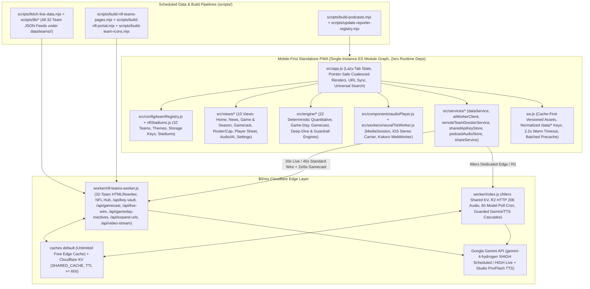

# Technical Architecture & Engineering Manual — 49ers Faithful & All-32 NFL Team Platform (`*.joshal.com` / `nfl.joshal.com`)

| Document Metadata | Details |
| :--- | :--- |
| **Flagship Brand** | **49ers Faithful** (`49ers Faithful Briefing` — `https://49ers.joshal.com`) |
| **Multi-Tenant Platform** | All 32 NFL Franchises (`https://<team>.joshal.com` via Cloudflare Pages `nfl-teams`) + **NFL Team Hub** (`https://nfl.joshal.com` via `nfl-joshal`) |
| **Target Runtime** | iOS 18+ Safari Standalone PWA (iPhone 16 / 16 Pro) & Mobile/Desktop Chrome |
| **Operating Cost** | **\$0/month** (GitHub Pages + GitHub Actions + Cloudflare Pages/Workers/KV Free Tier + Google AI Studio BYOK/Free Tier) |
| **Automated QA Matrix** | 6 suites: `npm test` (`unit-engines-qa.mjs`, `holistic-qa-regressions.mjs`, `timeliness-simulation-qa.mjs`, `e2e-mobile-qa.mjs`) + `npm run test:nfl` (`nfl-portal-qa.mjs`) + `npm run test:32teams` (`all-32-teams-qa.mjs`) |

---

## 1. Holistic System & Multi-Tenant Topology

The codebase powers a unified, zero-runtime-dependency Progressive Web App that runs identically across **33 production hosts** from a single shared frontend and engine codebase:

1. **Flagship San Francisco 49ers (`https://49ers.joshal.com`)**: Static PWA hosted on GitHub Pages (`CNAME` → `joshal7.github.io`) with optional dedicated Cloudflare Worker ([`worker/index.js`](file:///Users/joshal/workspace/49ers/worker/index.js)) backing shared KV caches, R2 audio streaming, and scheduled Gemini model discovery.
2. **All 32 Franchise Subdomains (`https://<team>.joshal.com`)**: Served via Cloudflare Pages Advanced Mode (`dist-nfl-teams/`, built by [`scripts/build-nfl-teams-pages.mjs`](file:///Users/joshal/workspace/49ers/scripts/build-nfl-teams-pages.mjs)) running [`worker/nfl-teams-worker.js`](file:///Users/joshal/workspace/49ers/worker/nfl-teams-worker.js). An edge `HTMLRewriter` streams zero-FOUC per-team `<title>`, WCAG CSS variables, team crests, `apple-touch-icon.png`, and dynamic `/manifest.json` per host, while `_routes.json` bypasses Functions for static JS/CSS/images and `/data/*` JSON.
3. **Unified NFL Team Hub (`https://nfl.joshal.com`)**: Single-screen 32-team NFC/AFC portal (`nfl-portal.html`, generated by [`scripts/build-nfl-portal.mjs`](file:///Users/joshal/workspace/49ers/scripts/build-nfl-portal.mjs) and deployed from the unified `dist-nfl-teams/` bundle via `worker/pages-nfl-joshal/wrangler.toml`) plus same-origin standalone PWA mode (`nfl.joshal.com/?team=<slug>`) and a hermetically CSP-sealed Gemini API Key Sync Vault (`/key-sync` + zero-knowledge AES-256-GCM `/api/key-vault` for WebAuthn Passkey PRF & passphrase sync across devices).

---

## 2. Core Engineering Philosophy: Quality vs. Speed Decision Matrix

Every subsystem adheres strictly to a two-tier latency and quality contract:

| Subsystem / Workflow | Priority Mode | Target Latency | Architectural Enforcement Mechanism |
| :--- | :--- | :--- | :--- |
| **Scheduled Daily Syntheses (`1/day 5:00 PM PT Top-News Brief`, `1/day Matchup Intel`, `aiSynthesisEngine.mjs`)** | **Maximum Reasoning Depth** (`XHIGH`) | Background / Cached (`< 50 ms` read) | Uses `gemini-4-hydrogen` at `thinkingLevel: "XHIGH"` with Google Search Grounding, `<= 1` call/cycle guards, `SHARED_AI_SINGLETON` dedup, and Cloudflare KV sharing (`SF_RESERVED_DAILY_CALLS = 6` on multi-team quota). |
| **Live User-Waiting AI Jobs (`Auto Pod`, `On-Demand Deep Analysis`)** | **Accuracy & Audio Realism Over Speed** (`HIGH` + Studio TTS) | `~15–40s` (Analysis) / `~30–120s` (Pod) | Runs `gemini-4-hydrogen` at `thinkingLevel: "HIGH"` over pre-compiled Stage-1 OverTheCap/EPA dossiers + live Search Grounding, cascading `gemini-2.5-pro-preview-tts` → `gemini-2.5-flash-preview-tts` (or WebWorker Kokoro ONNX fallback) after `humanizeNflTextForTts`. Supports direct browser BYOK keys synced across all 33 hosts via `/key-sync` + Passkey PRF. |
| **Game-Day Inactives AI Fallback (`/api/gameday-inactives`)** | **Fast Structured Extraction** (`LOW`) | `< 6s` (cooldown-gated) | Only invoked during `[T-90m, Final)` if official club RSS, RotoWire, ESPN Core Event Roster, and Sleeper lack `>= 3` scratches; selects **Top-Tier-Minus-1 Flash** (`rankSecondTierGeminiFlashModels`) at `thinkingLevel: "LOW"`. |
| **App Boot, Click Responsiveness & Offline Shell (`sw.js`, `src/app.js`, `src/styles.css`)** | **Sub-Second Instant Paint & First-Tap Registration** | `< 300 ms` boot; `< 16 ms` tab switch; `0` dropped taps | Single-instance ES module graph (zero `?v=` query strings on internal imports), SW **Cache-First** for versioned `/src/*.js`, `/src/*.css`, `/assets/*`, `/icons/*` with batched 8-at-a-time install precache, deferred `requestIdleCallback` IndexedDB persistence, `touch-action: manipulation` on all controls, and **pointer-safe coalesced background rendering (`requestBackgroundRender`)** that defers DOM replacement while a tap/scroll gesture is active and defers SW reload (`controllerchange`) during active interaction. |
| **Live Wire, Gamecast & Health Telemetry (`dataService.js`, `injuryProbabilityModel.js`, `gamecastEngine.js`)** | **Sub-Minute Real-Time Telemetry Without Socket Saturation** | `~28 ms` health reconcile; `2s/6s` Gamecast; `20s` live / `45s` standard wire | Bounded `mapWithConcurrency(..., 6)` HTTP pools, `WeakMap`-scoped per-channel cooldowns, adaptive ESPN overlay intervals (`24s` live / `30s` post-game / `45s` health / `60s` standard), `document.visibilityState === 'hidden'` timer pause, `parseJsonSafeResponse` HTML rejection, and per-team `~275 KB` ESPN injury endpoints (`94%` smaller than the `8.76 MB` league payload). |
| **Deterministic Simulators & Deep-Dive Analytics (`src/engine/`)** | **100% Synchronous Browser Determinism** | `0.03 ms` Cap; `84 ms` 10k MC; `3.7 ms` Big Board | Armchair GM `2026–2030` cap math, 10,000-iteration Empirical-Bayes Monte Carlo, 3-Lens Draft Big Board, Wave 1 & Wave 2 Deep-Dive analytics, and Universal Search run synchronously in-browser with zero network calls. |

---

## 3. Complete Time-Based Lifecycle & NFL Calendar Invariants

All time-sensitive engines use deterministic `America/Los_Angeles` (PT) and `America/New_York` (ET) `Intl.DateTimeFormat` wall-clock helpers so transitions are DST-exact across every device timezone and international game site:

| Window / Lifecycle Phase | Governing Functions | Exact Deterministic Behavior & Non-Conflict Guarantees |
| :--- | :--- | :--- |
| **Weekly Practice Window (`Mon`–`Thu` 12:15 PM PT)** | `getPracticeReportLeadDays`, `isBeforeWeeklyPracticeWindow`, `resolvePracticeSlotFromReportTiming` | Practice Day 1 opens at `12:15 PM PT` **`2` days** before `Wed` games, **`3` days** before `Thu`/`Fri` games, and **`4` days** before `Sat`/`Sun`/`Mon` games. Before Practice Day 1 (with no current-week wire reports), `W / T / F` renders `— / — / —`. |
| **Weekly NFL 53-Man IR Activation Deadline (`4:00 PM ET`, capped at `T-90m`)** | `evaluateWeeklyIrActivationWindow`, `computePlayerPlayProbability` | Locks at `4:00 PM ET` the day before `Sun`/`Sat`/daytime weekday games, or `4:00 PM ET` on game day for prime-time (`>= 6:00 PM ET`) `Thu`/`Fri`/`Mon` games. Unactivated open-window IR players revert to `0% • IR` until final whistle. |
| **Pre-Kickoff Game-Day Window (`[T-90m, Kickoff)`)** | `evaluateGameDayWindow`, `hydrateLiveGameDayRosters`, `reconcileGameDayActiveRoster`, `resolveNewsBriefCycleState` | Activates strictly for concrete unplayed games (`!completed && !isByeWeek && !opponent.isTbd`). Mounts Team & Opponent Game-Day Inactives + starting-collapsed Active Roster (`Offense → Defense → Special Teams`), enforces the **NFL 47/48 active game-day roster cap** (`48` with `>= 8` active OL, `47` otherwise) via authoritative ESPN Core Event Roster + deterministic backfill, distinguishes **Healthy Scratches / Coach's Decisions & Emergency 3rd QBs** with neutral slate styling (never red injury chips), resolves `Questionable → 99% In / 0% Out`, switches wire polling to `20s`, and holds the daily AI Top-News Brief credit for post-game. |
| **Live In-Game + Overtime (`[Kickoff, Final)`)** | `resolveGameNewsContext`, `is49ersGameLiveWindow`, `extractLiveInGameInjurySignals`, `gamecastEngine.js` | Keeps `20s` live wire polling and `2s` Gamecast play-by-play/field-visualizer polling active, renders `LIVE • Away–Home` scoreboards, elevates `LIVE INJURY UPDATE` sideline exits (`50% QTR` → `99% Returned` or `0% Out`) without mutating declared pre-kickoff Inactives, and demotes pre-game availability chatter. |
| **Immediate Post-Whistle (`0m` upon `completed === true`)** | `evaluateGameDayWindow`, `evaluateWeeklyIrActivationWindow`, `reconcileRosterAndHealthWithNews`, `hydrateLiveEspnOverlay` | The instant `completed === true` lands: `[T-90m, Final)` game-day blocks close, polling drops back to `45s`, `Week N` IR locks release immediately, `Matchup` & `Health` advance to `Week N+1` (`W/T/F = —`), cleared healthy starters & `Vet Rest` drop off `practiceReport`, and `resolveNewsBriefCycleState` unlocks `YYYY-MM-DD@postgame-wk{N}` once podium/recap coverage arrives. |
| **Bye Weeks, `TBD` Postseason & Offseason (`seasonConcluded`)** | `resolveCompleteScheduleModel`, `evaluateTradeDeadlineStatus`, `partitionCompletedTradesByWindow`, `draftBigBoardEngine.js` | Explicit `isByeWeek` and `isTbd` guards prevent phantom `inGame` triggers, skip `teams/tbd/*` fetches, and exclude Bye weeks from the 4-game IR minimum. Once eliminated or post-Super Bowl (`seasonConcluded`), scoreboards render `FINAL • X–Y` (`Season Complete`), IR players hold at `0% • IR`, video retention widens `16d → 90d`, and First-Pick Mock Draft window tightens `30d → 7d` post-Super Bowl. |

---

## 4. Complete Repository & Module Map

### 4.1 Entry Shell, Styles, Config & Service Worker

| File Path | Responsibilities |
| :--- | :--- |
| [`index.html`](file:///Users/joshal/workspace/49ers/index.html) | Standalone PWA shell (`viewport-fit=cover`, `referrerpolicy="no-referrer"`), zero-FOUC theme bootstrapper & early-tap replay queue, sticky header (`#nflHubBackBtn`, `#brandHomeTrigger`, `#openSearchBtn`, `#openSettingsBtn`), `<main id="mainView">`, `#jargonPopover`, sticky `#miniPlayer`, 5-tab `.bottom-nav`, `#statRankModalBackdrop` modal, and `#bottomSheetBackdrop` slide-up drawer. |
| [`sw.js`](file:///Users/joshal/workspace/49ers/sw.js) | Multi-host Service Worker (`49ers-faithful-v*` / `<slug>-hq-v*` / `nfl-hub-v*`). **Cache-First** for version-scoped `/src/*.js`, `/src/*.css`, `/assets/*`, `/icons/*`, and `.m4a`/`.mp3` streams; **Network-First** (`2.2s` warm-cache timeout / `7.5s` cold) for HTML and `/data/*.json` with `?t=` cache-key normalization; batched 8-socket install precaching; strict bypass for HTTP `Range`, `/api/*`, `/v1beta/*`, and `/key-sync`. |
| [`src/app.js`](file:///Users/joshal/workspace/49ers/src/app.js) | Central state & event delegation controller, single-instance ES module graph, pointer-safe coalesced background rendering (`requestBackgroundRender`), `
` state preservation across background updates, rAF-batched header/scroll layout sync, deferred SW reload on `controllerchange`, `visibilityState`-aware adaptive live wire/ESPN/Gamecast polling, Universal Search, Passkey PRF key sync, and `window.__49ersDiagnostics`. |
| [`src/styles.css`](file:///Users/joshal/workspace/49ers/src/styles.css) | Multi-team CSS variable token system (all 32 team Light & Dark themes), `touch-action: manipulation` across interactive elements, sticky Column 1 narrow health tables, neutral healthy-scratch vs. red injury badges, live Gamecast field visualizer styles, and 8-viewport responsive portrait/landscape geometry. |
| [`src/config/teamRegistry.js`](file:///Users/joshal/workspace/49ers/src/config/teamRegistry.js) & [`src/config/nflStadiums.js`](file:///Users/joshal/workspace/49ers/src/config/nflStadiums.js) | Single source of truth for all 32 NFL franchises (slugs, subdomains, ESPN IDs, OTC slugs, divisions, light/dark palettes, per-team `localStorage` keys, NFL Hub mode detection) and 32 stadium/roof/altitude profiles. |

### 4.2 All 22 Deterministic Client Engines (`src/engine/`)

| Engine File | Key Responsibilities & Invariants |
| :--- | :--- |
| [`seasonStateMachine.js`](file:///Users/joshal/workspace/49ers/src/engine/seasonStateMachine.js) | Year-round permanent view model (`0` archived/hidden views), 6-card default `Home` dashboard + 6 optional pinnable cards, `resolveCompleteScheduleModel` (`PRE`/`REG`/`POST`), `evaluateTradeDeadlineStatus`, `partitionCompletedTradesByWindow`, and trailing `30d`/`7d` Mock Draft window (`ROSTER_SORT_FIELDS` exported from `src/views/rosterCapView.js`). |
| [`draftBigBoardEngine.js`](file:///Users/joshal/workspace/49ers/src/engine/draftBigBoardEngine.js) | 3-Lens 250+ Prospect NFL Draft Big Board (`Consensus`, `Likely`, `PFF`), `NR`-at-bottom sorting, Steal/Reach deltas, multi-filters, and shareable URL query sync. |
| [`capSimulator.js`](file:///Users/joshal/workspace/49ers/src/engine/capSimulator.js) | 5-year (`2026–2030`) OverTheCap CBA calculator (`0.03 ms`): Pre/Post-June 1 Cuts & Trades, Restructures, Extensions, Top-53 replacement, `>2` Post-June 1 CBA warning, and Article 13 rollover math. |
| [`injuryProbabilityModel.js`](file:///Users/joshal/workspace/49ers/src/engine/injuryProbabilityModel.js) | Player-specific play likelihood (`0–99%`), veteran rest vs. acute soft-tissue priors, short-week practice lead days, weekly `4:00 PM ET` IR activation lock + `0m` post-whistle rollover, WeakMap-indexed wire corroboration, and `reconcileRosterAndHealthWithNews` (`~28 ms`). |
| [`gameDayRosterEngine.js`](file:///Users/joshal/workspace/49ers/src/engine/gameDayRosterEngine.js) | `[T-90m, Final)` Team & Opponent Game-Day Inactives + starting-collapsed Active Roster, NFL 47/48 active game-day cap (`enforceNflGameDayActiveCap`), Healthy Scratch / Coach's Decision / Emergency 3rd QB classification (`isNonMedicalScratchReason`), canonical Club RSS + RotoWire + ESPN Core Event Roster parsers (shared with both Edge Workers), live sideline injury tracking, and `Week N+1` practice rollover. |
| [`gamecastEngine.js`](file:///Users/joshal/workspace/49ers/src/engine/gamecastEngine.js) | Live & historical Gamecast model: yard-line field visualizer, win-probability & scoring-play summaries, drive breakdowns, team/player box scores, situational down-and-distance telemetry, and adaptive `2s` live / `6s` replay polling state. |
| [`teamDeepDiveEngine.js`](file:///Users/joshal/workspace/49ers/src/engine/teamDeepDiveEngine.js) | Wave 1 & Wave 2 Deep-Dive analytics across all 32 teams: team offensive/defensive tendencies, red-zone & third-down efficiency, explosive-play rates, pass-protection/pressure splits, and roster age/draft-capital profiles. |
| [`powerRankingsEngine.js`](file:///Users/joshal/workspace/49ers/src/engine/powerRankingsEngine.js) | Deterministic 32-team composite power rankings blending Empirical-Bayes win-rate, SOS-adjusted point differential, offensive/defensive EPA, and injury availability adjustments. |
| [`playoffMonteCarlo.js`](file:///Users/joshal/workspace/49ers/src/engine/playoffMonteCarlo.js) | Seeded 10,000-iteration conference Monte Carlo simulator (`~84 ms`) with Empirical-Bayes power shrinkage, Common Random Numbers rooting leverage, and full NFL 2-club/3+-club tiebreakers. |
| [`statsLeaderboardEngine.js`](file:///Users/joshal/workspace/49ers/src/engine/statsLeaderboardEngine.js) | 4-unit Team Stats (`Offense`, `Defense`, `Special Teams`, `Penalties & Turnovers`), Overall Composite Rank tooltips, clickable 32-team leaderboard modals, live standings refresh, and position-specific 2026 & Career player tables. |
| [`universalSearchEngine.js`](file:///Users/joshal/workspace/49ers/src/engine/universalSearchEngine.js) | Sub-10ms cross-entity search across active & opponent rosters, beat reporters/sources, tweets, articles, videos, podcasts, cap contracts, and glossary terms. |
| [`digestExperienceEngine.js`](file:///Users/joshal/workspace/49ers/src/engine/digestExperienceEngine.js) | Read/seen state tracking, "Since You Last Visited" catch-up watermarks, Top vs. Latest feed sorting, and card density preferences. |
| [`salientMediaEngine.js`](file:///Users/joshal/workspace/49ers/src/engine/salientMediaEngine.js) | Editorial photo, player cutout, dual-crest matchup, and linked-article thumbnail selection with slot-appropriate CDN image sizing and graceful fallback chains. |
| [`breakingClassifier.js`](file:///Users/joshal/workspace/49ers/src/engine/breakingClassifier.js) | Hybrid `StoryRank` ranker, strict lead-claim `BREAKING` scarcity (`<= 8h` Tier-1, `<= 4.5h` Tier-2, max 3), cross-format story clustering (`+N related`), `Film & Trench` vs. `Highlights & Videos` classification, `resolveNewsBriefCycleState`, `is49ersGameLiveWindow`, and expandable long-summary splitting. |
| [`antiFluffFilter.js`](file:///Users/joshal/workspace/49ers/src/engine/antiFluffFilter.js) | Clickbait/rage-bait detector, analytical/EPA/scheme salience scorer, and per-user reporter/outlet mute filter. |
| [`beatAttributionEngine.js`](file:///Users/joshal/workspace/49ers/src/engine/beatAttributionEngine.js) | Multi-team & 49ers reporter directory, 4 Settings-synced `<= 500`-char `Direct X Beat Lists`, podium-subject authorship guard, X-first permalink resolver, and multi-reporter corroboration clustering. |
| [`groundingValidator.js`](file:///Users/joshal/workspace/49ers/src/engine/groundingValidator.js) | `DISALLOWED_FORMER_49ERS` anti-hallucination guardrail, cross-team contamination filter, and authoritative live context snapshot builder. |
| [`linkIntegrity.js`](file:///Users/joshal/workspace/49ers/src/engine/linkIntegrity.js) | Enforces `https://`, blocks paywalls/404s/shorteners/Google News wrappers, strips `utm_*`, filters off-topic fantasy/betting filler, validates allowlisted inline MP4 hosts, and resolves `nflverse`/ESPN/PFR/OTC player homonyms. |
| [`geminiStudioPrompts.js`](file:///Users/joshal/workspace/49ers/src/engine/geminiStudioPrompts.js) | Model-ranking selectors (`rankBestGeminiReasoningModels`, `rankSecondTierGeminiFlashModels`), `XHIGH`/`HIGH`/`LOW` `thinkingConfig` builders, Stage 1–3 Deep Analysis & NotebookLM script prompts, and multi-speaker TTS chunking. |
| [`jargonGlossary.js`](file:///Users/joshal/workspace/49ers/src/engine/jargonGlossary.js) | 50+ scheme, analytics, and CBA glossary definitions with XSS-safe inline dotted-underline annotation and viewport-clamped `#jargonPopover` rendering. |
| [`podcastSpeechEngine.js`](file:///Users/joshal/workspace/49ers/src/engine/podcastSpeechEngine.js) & [`deepResearchEngine.js`](file:///Users/joshal/workspace/49ers/src/engine/deepResearchEngine.js) | `humanizeNflTextForTts` spoken-football converter, conversational turn prosody, 44.1 kHz 7-stage broadcast DSP mastering, and deterministic Stage-1 Deep Research Dossier + fallback synthesis. |

### 4.3 Services, Web Workers, Components & Views

| File Path | Responsibilities |
| :--- | :--- |
| [`src/services/dataService.js`](file:///Users/joshal/workspace/49ers/src/services/dataService.js) | Resilient `fetchJsonSafe` (`parseJsonSafeResponse` rejecting `200 OK` HTML), GitHub Raw fallback for all 32 teams, deferred `requestIdleCallback` IndexedDB bundle caching, bounded `mapWithConcurrency(..., 6)` live beat wire with `WeakMap` per-channel cooldowns, adaptive live ESPN overlay, team-scoped Gamecast local cache (`joshal_<abbr>_gamecast_cache_v2`), and live podcast RSS hydration. |
| [`src/services/aiWorkerClient.js`](file:///Users/joshal/workspace/49ers/src/services/aiWorkerClient.js) | Unified `SHARED_AI_SINGLETON` locks, HTML-guarded JSON parsing (`parseJsonResponseOrThrow`), `refreshDailyTopNewsBriefIfDue` (`5:00 PM PT` / post-game `XHIGH`), `refreshDailyMatchupIntelIfDue` (`1/day` `XHIGH`), `fetchGeminiFallbackGameDayInactives` (`LOW`), `runOnDemandDeepAnalysis` (`HIGH`), and `generateOnDemandAutopodcast` (`HIGH` + Studio TTS / WebWorker Kokoro). |
| [`src/services/remoteTeamDossierService.js`](file:///Users/joshal/workspace/49ers/src/services/remoteTeamDossierService.js) | Cross-team native player dossier loader: fetches opponent/other-team roster, stats, spider chart, and contract data from `/data/teams/<slug>/` so tapping any NFL opponent player opens a full native 5-tab dossier without leaving the app. |
| [`src/services/sharedApiKeyStore.js`](file:///Users/joshal/workspace/49ers/src/services/sharedApiKeyStore.js) | Cross-subdomain Gemini API key sync via hermetic `nfl.joshal.com/key-sync` iframe + zero-knowledge client-encrypted AES-256-GCM `/api/key-vault` with 1-tap WebAuthn Passkey PRF and passphrase unlock across all 33 origins. |
| [`src/services/podcastAudioStore.js`](file:///Users/joshal/workspace/49ers/src/services/podcastAudioStore.js) & [`src/services/shareService.js`](file:///Users/joshal/workspace/49ers/src/services/shareService.js) | CacheStorage/IndexedDB audio persistence, 48 kbps MP3 export (`lamejs`), gzip base64url `?pod=`/`?analysis=` sharing, and Web Share Level 2. |
| [`src/workers/neuralTtsWorker.js`](file:///Users/joshal/workspace/49ers/src/workers/neuralTtsWorker.js) | Off-main-thread Web Worker running `kokoro-js` (`Kokoro-82M-v1.0-ONNX`) local neural TTS. |
| [`src/components/audioPlayer.js`](file:///Users/joshal/workspace/49ers/src/components/audioPlayer.js) & [`src/components/spiderChart.js`](file:///Users/joshal/workspace/49ers/src/components/spiderChart.js) | Sticky mini-player, `MediaSession` controls, iOS `AVAudioSessionCategoryPlayback` + 2-channel Stereo `-84 dBFS` dithered WAV speaker unlock, and 10-axis `0–100th` percentile SVG radar charts. |
| `src/views/*` (`homeView.js`, `newsView.js`, `seasonMatchupView.js`, `gamecastView.js`, `rosterCapView.js`, `playerSheetView.js`, `audioAiView.js`, `settingsArchiveView.js`, `uiHelpers.js`, `icons.js`) | All 5 primary tabs, live/historical Gamecast sheet, cross-team native 5-tab Player Dossier, Universal Search modal, unified Saved Audio/AI libraries, and Settings (team switcher, Passkey key sync, beat filters, display/theme). |

### 4.4 Serverless Edge Workers & Build Pipelines (`worker/`, `scripts/`)

| File Path | Responsibilities |
| :--- | :--- |
| [`worker/nfl-teams-worker.js`](file:///Users/joshal/workspace/49ers/worker/nfl-teams-worker.js) | Unified 32-Team + NFL Hub Cloudflare Pages `_worker.js`: zero-FOUC `HTMLRewriter` (`/` & `/index.html`, `Cache-Control: public, max-age=0, must-revalidate`, `Vary: Host`), `/manifest.json`, `/apple-touch-icon.png`, `/data/*`, team-aware CORS, explicit `404 JSON` guard on unmatched `/api/*`, `/key-sync` + `/api/key-vault`, `/api/health`, `/api/gamecast` (shared upstream summary cache), `/api/live-wire`, canonical `/api/gameday-inactives`, `caches.default`-cached `/api/expand-urls` (`HEAD -> GET`, 13-host allowlist + UTM strip), `/api/video-stream` (`isAllowedInlineVideoStreamUrl` + post-redirect check + CORP), quota-protected `/api/daily-news-brief` & `/api/matchup-intel`, and BYOK-gated `/api/analyze` & `/api/podcast`. |
| [`worker/index.js`](file:///Users/joshal/workspace/49ers/worker/index.js) | Dedicated 49ers Cloudflare Worker: `caches.default` caching for high-frequency `/api/live-wire` (bounded `<=14` X hydrates, 0 KV writes), `/api/expand-urls`, and `/api/gameday-inactives`; KV (`expirationTtl >= 60`) for durable `/api/daily-news-brief`, `/api/matchup-intel`, `/api/shared-feed`, `/api/model-status`, `/api/push-config|subscribe|unsubscribe`, `/api/analyze`, and `/api/podcast`; R2 HTTP `Range` `206` `/api/audio/:episodeId`; `/api/gamecast`; `/api/video-stream`; `/api/health`; timeout-guarded Gemini/TTS cascades (`AbortSignal.timeout`); anchored localhost CORS; `404 JSON` on unknown `/api/*`; and 6-hour `/v1beta/models` cron. |
| [`scripts/fetch-live-data.mjs`](file:///Users/joshal/workspace/49ers/scripts/fetch-live-data.mjs) | Unified 32-team pipeline compiling verified live JSON feeds for all 32 NFL franchises (`/data/teams/<slug>/*.json`). |
| [`scripts/build-nfl-teams-pages.mjs`](file:///Users/joshal/workspace/49ers/scripts/build-nfl-teams-pages.mjs), [`scripts/build-nfl-portal.mjs`](file:///Users/joshal/workspace/49ers/scripts/build-nfl-portal.mjs), [`scripts/build-team-icons.mjs`](file:///Users/joshal/workspace/49ers/scripts/build-team-icons.mjs), [`scripts/build-podcasts.mjs`](file:///Users/joshal/workspace/49ers/scripts/build-podcasts.mjs), [`scripts/update-reporter-registry.mjs`](file:///Users/joshal/workspace/49ers/scripts/update-reporter-registry.mjs) | Builds `dist-nfl-teams/` & `dist-nfl/` Cloudflare Pages bundles, generates 32 team icons & crests, encodes 44.1 kHz studio `.m4a` podcasts, and ranks beat reporters. |

---

## 5. Mobile UX & Viewport Geometry Invariants

Verified across 8 viewports (`320x640` through `1280x900`) by [`tests/e2e-mobile-qa.mjs`](file:///Users/joshal/workspace/49ers/tests/e2e-mobile-qa.mjs), [`tests/nfl-portal-qa.mjs`](file:///Users/joshal/workspace/49ers/tests/nfl-portal-qa.mjs), and [`tests/all-32-teams-qa.mjs`](file:///Users/joshal/workspace/49ers/tests/all-32-teams-qa.mjs):
1. **5-Tab Bottom Navigation**: `Home` (`home`) → `News & Film` (`news`) → `Game & Season` (`season`) → `Roster & Cap` (`roster`) → `Audio & AI` (`audio`).
2. **Two-Row 6-Filter `News & Film` Bar (`0px` Horizontal Scroll)**: Row 1 = `All`, `Tweets`, `Articles`; Row 2 = `Highlights & Videos`, `Film & Trench`, `Trades & Roster` (zero `Synthesis Briefs` tabs).
3. **Two-Cluster `Game & Season` Bar (`0px` Horizontal Scroll, Year-Round Permanent)**: Bar 1 = `Matchup`, `Health`, `Schedule`, `Stats`; Bar 2 = `Trade`, `Playoffs`, `Draft`, `Draft Recap` (zero `.off-cycle` dimming, zero `#phaseBanner`, zero Archive Vault).
4. **Frozen Sticky Column 1 Health Tables + Game-Day Healthy Scratches**: Both team `Health` and `Matchup` health tables freeze Column 1 (`position: sticky; left: 0`) over solid backgrounds, enforce the 47/48 active cap, and render Healthy Scratches / Coach's Decisions in neutral slate styling distinct from red injury badges.
5. **Single-Screen Portrait Team Stats, NFL Hub & Full 9-Column Landscape Cap Fit**: `Team Stats` fits above `.bottom-nav` in mobile portrait; `nfl.joshal.com` fits all 32 team tiles on one screen; `table.cap-sim-table` fits all 9 columns without scrolling in `852x393` & `874x402` landscape.
6. **Roster Sort UX**: Single `#rosterSortSelect` dropdown (default `jersey` asc) + `#rosterSortDirBtn` Up/Down toggle + 2 filter rows (`Unit` + `Position Group`), zero sort pills.

---

## 6. Automated 6-Suite QA Verification Matrix

1. **[`tests/unit-engines-qa.mjs`](file:///Users/joshal/workspace/49ers/tests/unit-engines-qa.mjs)**: All 22 deterministic engines, 5-year OverTheCap math, 21-day IR & short-week practice windows, `[T-90m, Final)` 47/48 active cap & healthy scratch rules, 3-Lens Big Board, Gamecast & Deep-Dive engines, `5,400+` HTTPS URLs across `/data/*.json`, single-instance ES module graph check, Worker KV TTL & `404 JSON` guards, HTTP `Range` `206` & `/api/video-stream` security, and `<50 ms` engine latency budgets.
2. **[`tests/holistic-qa-regressions.mjs`](file:///Users/joshal/workspace/49ers/tests/holistic-qa-regressions.mjs)**: Multi-year `2027–2030+` calendar rollovers, 17-game standings conservation, X-first link priority, Daily Brief citations, 4-unit Team Stats leaderboards, and full 21-day IR lifecycle transitions.
3. **[`tests/timeliness-simulation-qa.mjs`](file:///Users/joshal/workspace/49ers/tests/timeliness-simulation-qa.mjs)**: Q3 live in-game wire priority, `0m` post-whistle & 5:00 PM PT recaps, Monday rollover, `5.5h` injury half-life decay, mid-week All-22 film elevation, and live-to-final race conditions.
4. **[`tests/e2e-mobile-qa.mjs`](file:///Users/joshal/workspace/49ers/tests/e2e-mobile-qa.mjs)**: Headless Chrome CDP E2E across 8 viewports (`320x640`–`1280x900`) verifying every tab, Gamecast, Universal Search, cross-team player sheet, pointer-safe first-tap responsiveness during background renders, `touch-action: manipulation`, inline video/audio playback, `0px` horizontal overflow, and `0` console/page/network errors.
5. **[`tests/nfl-portal-qa.mjs`](file:///Users/joshal/workspace/49ers/tests/nfl-portal-qa.mjs)**: Verifies `nfl.joshal.com` single-screen 32-team portal geometry, light/dark themes, same-origin `/?team=<slug>` Hub mode, `/key-sync` CSP & vault security, and zero console/overflow errors.
6. **[`tests/all-32-teams-qa.mjs`](file:///Users/joshal/workspace/49ers/tests/all-32-teams-qa.mjs)**: Verifies all 32 team data bundles, themes, icons, zero cross-team 49ers contamination leaks, and multi-team Worker routing.
