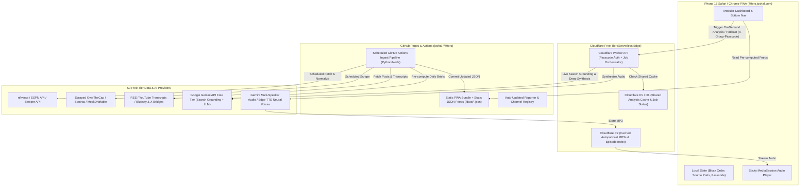

# Product Requirements Document (PRD): 49ers Nerd HQ (`49ers.joshal.com`)

| Metadata | Details |
| :--- | :--- |
| **Product Name** | **49ers Nerd HQ** (Working Title: *The Faithful Briefing / Red & Gold War Room*) |
| **Production URL** | `https://49ers.joshal.com` (CNAME → `joshal7.github.io`) |
| **Repository** | `https://github.com/Joshal7/49ers` |
| **Target Platform** | Mobile Web PWA (iOS 18+ Safari "Add to Home Screen" on iPhone 16 & Mobile Chrome) |
| **Target Audience** | Josh & ~24 die-hard, analytically minded 49ers-fan friends |
| **Operating Budget** | **Strictly \$0/month** (100% Free-Tier Infrastructure, Open NFL Datasets, & Free-Tier AI/TTS APIs) |
| **Design Philosophy** | High-signal football intelligence, zero clickbait/fluff, deep X's & O's, salary cap mechanics, and quantitative modeling |

---

## 1. Executive Summary & Product Vision

**49ers Nerd HQ (`49ers.joshal.com`)** is a private-group, mobile-first Progressive Web App (PWA) built for ~25 deeply knowledgeable San Francisco 49ers fans who want **facts, film/scheme takeaways, quantitative modeling, and salary cap mechanics**—stripped of sensationalized clickbait and engagement-farming hot takes.

Modeled after the zero-cost GitHub Pages deployment pattern of `workouts.joshal.com`, the app combines:
1. **Automated Scheduled Ingestion (GitHub Actions)**: Continually pulls and normalizes 49ers roster data, play-by-play EPA/NextGen metrics (`nflverse`), OverTheCap/Spotrac contract structures, combine spider-chart percentiles, injury/practice logs, betting lines, and content from the top 30–50 49ers beat reporters, national insiders, and YouTube film channels.
2. **On-Demand AI Deep Synthesis & "Autopodcast" Engine (Cloudflare Workers + R2 + Gemini API Free Tier)**: Allows any member of the friend group (authenticated via a shared group passcode) to trigger multi-minute deep-dive analyses or generate custom-duration, multi-speaker audio podcasts on the fly—which are immediately cached and shared with all ~25 friends.
3. **Season-Aware Dynamic Information Architecture**: Automatically adapts its dashboard modules to the NFL calendar and the 49ers' real-time status (Regular Season, Oct 1–Nov Trade Window, Final 5-Week Playoff Push, Post-Elimination Draft Prep, and Live Draft/UDFA Recap) while allowing each user to drag-and-drop high-level dashboard blocks to match their personal priority.

---

## 2. Target Audience & Editorial Guardrails

### 2.1 Audience Profile
* **Users**: Josh + ~24 close friends.
* **Football IQ**: High. Users understand EPA/play, CPOE, success rate, DVOA concepts, Restructure vs. Post-June 1 cut mechanics, 11 vs. 21 personnel tendencies, Wide-9 defensive line alignments, and Kyle Shanahan / John Lynch roster-building archetypes.
* **Primary Device Context**: iPhone 16 running iOS Safari via a Home Screen Web App shortcut (`display: standalone`), plus Mobile Chrome.

### 2.2 Strict "No-Fluff / Anti-Sensationalism" Editorial Engine
Every AI synthesis prompt and feed classifier must enforce the **Nerd HQ Editorial Charter**:
1. **Ban Clickbait & Manufactured Drama**: Automatically filter out or down-rank speculative tabloid framing (e.g., *"You won't believe what Player X posted on Instagram"*, unverified trade bait blogs, or national talking-head rage-bait).
2. **Separate Fact, Film, and Projection**:
   * **Verified Facts**: Official transactions, practice participation designations, contract numbers, snap counts, and direct coach/player quotes.
   * **Film & Scheme Analysis**: Coverage shells, pass-protection slide adjustments, run-blocking concepts (outside zone vs. duo/gap), pressure rates.
   * **Quantitative Projections**: Explicit probability models with stated assumptions.
3. **Source Attribution & Credibility Tiering**: Every synthesized claim cites the originating reporter(s) (e.g., `[Maiocco, Barrows]`) or dataset (`[nflverse, OTC]`) with direct links/timestamps.
4. **Occasional High-IQ Fun Facts**: Include verified statistical anomalies or historical franchise nuggets (e.g., *"First 49ers rookie LB since Patrick Willis in 2007 to record..."*) without filler prose.

---

## 3. System Architecture (\$0/Month Hybrid Stack)

### 3.1 Three-Tier Execution Model
1. **Static Frontend & Pre-Computed Data (GitHub Pages)**:
   * Hosted at `https://49ers.joshal.com` from `github.com/Joshal7/49ers`.
   * Serves the mobile web app (`index.html`, `manifest.json`, `sw.js`) and pre-compiled static JSON data payloads (`/data/roster.json`, `/data/cap.json`, `/data/news_clusters.json`, `/data/matchup.json`, `/data/health.json`, `/data/seasonal.json`).
2. **Scheduled Data Ingestion & Auto-Discovery Pipeline (GitHub Actions)**:
   * Runs on a scheduled cron (every 2–4 hours in-season; daily off-season; every 15 minutes during active Draft/Trade Deadline windows).
   * Executes Python/Node scripts using **nflverse (`nfl_data_py`)**, ESPN public JSON endpoints, YouTube transcript extractors (`youtube-transcript-api`), RSS/Bluesky/syndication feeds, and HTML parsers for OverTheCap/Spotrac/MockDraftable.
   * Runs batch Gemini API syntheses to generate daily "Fact & Film Briefs" and commits updated JSON files back to a `data` branch/directory.
3. **On-Demand Deep Analysis & Autopodcast Engine (Cloudflare Workers + KV/D1 + R2 — 100% Free Tier)**:
   * Protected by a **Shared Friend-Group Passcode** (entered once per device and stored in `localStorage`).
   * Handles long-running on-demand requests (30 seconds to 3 minutes) where a user clicks **"Run Deep Analysis"** or **"Generate Autopodcast"**.
   * **Shared Group Caching**: Every on-demand analysis and generated podcast is stored in Cloudflare KV/D1 and R2 (10 GB free storage, zero egress fees). When Friend A waits 90 seconds to generate a *"10-minute deep dive on our Nickel CB coverage options vs. Seattle"*, Friends B through Y see it instantly in the shared feed with zero wait time and zero duplicate API calls.

---

## 4. Seasonal & Temporal State Machine

The app dynamically computes active modules based on the current date, the NFL schedule, and the 49ers' live season status:

| Phase ID | Trigger Window | Active Temporal / Seasonal Modules | Auto-Retirement Behavior |
| :--- | :--- | :--- | :--- |
| **`YEAR_ROUND`** | 365 days/year | **1. Roster & Depth Chart** **2. Team News & Beat Synthesis** **3. Matchups & Schedule** **4. Salary Cap & GM Simulator** **Bonus: Autopodcast Studio** | Always visible on Dashboard & Bottom Nav. |
| **`IN_SEASON`** | NFL Kickoff Week (early Sept) → Moment 49ers season ends | **5A. Team Health & Injury Priors** **5B. Team Stats & Power Rankings** **5C. Upcoming Matchup War Room** | Collapses into "Season Recap Archive" once 49ers are eliminated or win Super Bowl. |
| **`TRADE_WINDOW`** | **Oct 1 (00:00 PT) → NFL Trade Deadline** (First Tuesday after Week 9, 1:00 PM PT) | **6. Trade Deadline War Room** (Needs, Fits, Cap/Pick Costs, Verified Rumors) | Automatically leaves the main dashboard after Trade Deadline passes; final trade grades move to Archive Drawer. |
| **`PLAYOFF_PUSH`** | **5 Weeks Before Regular Season Ends (Week 14) → End of Regular Season (Week 18)** *(if not mathematically eliminated)* | **7. Playoff Picture & Seeding Simulator** (Monte Carlo Odds, Seed Paths, Weekly Rooting Guide) | Automatically transitions to Post-Season Bracket Tracker if 49ers make playoffs, or hides once regular season concludes. |
| **`DRAFT_PREP`** | **Moment 49ers are eliminated from Post-Season (or post-Super Bowl) → Start of NFL Draft Round 1** | **8. Draft War Room** (Needs, Consensus Big Board, Mock Aggregator, 49ers Fit Scorer, Combine Hub) | Automatically transitions into `DRAFT_LIVE_UDFA` when Round 1 begins. |
| **`DRAFT_LIVE_UDFA`** | **Day 1 of NFL Draft → 14 Days Post-UDFA Signing Window (~Mid-May)** | **9. Draft Class & UDFA Breakdown** (Pick-by-Pick Grades, College Film & Highlight Reels, Scheme Role) | Moves to the "Off-Season / Draft Archive Drawer" after Rookie Minicamp concludes. |

> [!TIP]
> **Archive / Off-Season Drawer**: Even when a temporal section auto-retires from the main dashboard (e.g., Trade Deadline in December or Draft Class in October), users can open the **"Archive & Off-Cycle Vault"** from the bottom navigation or settings menu to inspect past draft classes, prospect spider charts, or trade deadline histories year-round.

---

## 5. UX, Navigation & Visual Design Specifications

### 5.1 Visual Identity: "Levi's Night Game" Pro Analytics Theme
* **Primary Background**: Deep Obsidian (`#0B0D10`) and Elevated Slate Card (`#14181F`) for maximum contrast on OLED iPhone 16 screens.
* **Brand Accents**:
  * **49ers Scarlet (`#AA0000` / Highlight `#D11919`)**: Primary interactive actions, high-priority badges, offensive/team highlights.
  * **Metallic Saloon Gold (`#B3995D` / Soft Gold `#D4BC7E`)**: Key borders, championship/pro-bowl indicators, cap restructuring highlights, active tab indicators.
* **Semantic Data Colors**:
  * Elite / >= 80th Percentile / Full Practice: Emerald (`#10B981`)
  * Average / 40th–79th Percentile / Limited Practice: Amber (`#F59E0B`)
  * Concern / < 40th Percentile / DNP / Dead Cap Warning: Crimson (`#EF4444`)
* **Typography**:
  * **UI & Editorial**: `Inter` or system `-apple-system` (`SF Pro Text`) for crisp legibility.
  * **Data Tables, Cap Figures & Percentages**: `JetBrains Mono` or `SF Mono` with `font-variant-numeric: tabular-nums` so columns of cap dollars and EPA metrics align to the pixel.
* **Theme Toggle**: Settings includes a 1-tap toggle to switch between **"Levi's Night Game" (Dark - Default)** and **"'94 Throwback White & Gold" (Light Mode)** for bright stadium/daylight viewing.

### 5.2 Mobile Navigation & Reorderable Block Architecture
1. **Home Dashboard (Customizable Vertical Stack)**:
   * Displays high-level summary cards for all currently active Year-Round, In-Season, and Temporal sections.
   * **Drag-and-Drop Customization**: A `"Customize Layout ⇅"` pill at the top (or long-press on any card header) lets the user drag high-level section blocks up or down. Order is persisted per device in `localStorage` (with sensible seasonal defaults so newly activated temporal blocks like *Trade Deadline* or *Playoff Push* surface near the top).
   * **Progressive Disclosure**: Each dashboard card shows the top 3–4 highest-signal data points at a glance (e.g., Current Effective Cap Space, Top 3 News Briefs, Next Game Spread + Key Injury Alerts) with a `"Deep Dive →"` action that opens the full interactive view or slide-up bottom sheet.
2. **Sticky Bottom Navigation Bar (5 Tabs)**:
   * `🏠 Home` (Customizable Modular Dashboard)
   * `📰 News & Film` (Clustered Beat Synthesis, Video Clips, Raw Feed)
   * `🏈 Roster & Cap` (53-Man + PS + IR, Interactive Depth Chart, Armchair GM Cap Simulator)
   * `📊 Game / Season` (Context-aware: Matchup, Team Health, Stats, plus active Trade/Playoff/Draft modules)
   * `🎧 Audio & AI` (On-Demand Deep Analysis Runner + Autopodcast Studio & Shared Library)
3. **Persistent Mini-Player**:
   * When an Autopodcast is playing, a compact 56px docked bar sits directly above the bottom tab bar with Play/Pause, `-15s / +30s` skip, playback speed (`1.0x`, `1.25x`, `1.5x`, `2.0x`), and full iOS Lock Screen integration via `navigator.mediaSession`.

---

## 6. Detailed Functional Requirements by Section

### Section 1: Year-Round — Roster, Player Dossiers & Dual Depth Chart

#### 1.1 Roster Explorer
* **Coverage**: Full 90-man offseason / 53-man active roster + Practice Squad + Injured Reserve (IR) / PUP / NFI.
* **Search, Sort & Filter Controls**:
  * Instant search by Player Name or Jersey Number.
  * Unit Filter Pills: `All` | `Offense` | `Defense` | `Special Teams` + Position Group chips (`QB`, `RB/FB`, `WR`, `TE`, `OL`, `DL/EDGE`, `LB`, `CB`, `S`, `ST`).
  * Sort Options: `Jersey #`, `Cap Hit (Current Year)`, `Snap %`, `EPA / Efficiency Rank`, `Age`, `Contract Expiry Year`.

#### 1.2 Tabbed Player Dossier (Slide-Up Bottom Sheet)
Tapping any player opens a rich, 5-tab mobile bottom sheet:
1. **`Overview & News`**:
   * Bio (Age, Height, Weight, Draft Year/Round/Pick, College, Accrued Seasons, Free Agency Year/Type: UFA/RFA/ERFA).
   * Live Injury Designation & Next-Game Play Likelihood % badge.
   * Player-specific news & beat reporter mentions from the last 30 days.
2. **`Stats & Advanced (EPA / NextGen / PFF)`**:
   * **Toggle**: `Current Season` | `Career Year-by-Year` | `Postseason`.
   * **Standard Stats** (ESPN-style): Passing/Rushing/Receiving/Tackles/Sacks/INTs.
   * **Open Advanced Analytics (`nflverse`)**:
     * *QBs*: EPA/play, CPOE, Success Rate, Air Yards/Att, Pressure-to-Sack %, Time to Throw.
     * *Skill (RB/WR/TE)*: EPA/touch, Target Share, Air Yards Share, YAC Over Expected (NGS), Separation (NGS), Rush Yards Over Expected per Att (RYOE).
     * *OL/DL/LB/DB*: Snap share %, Pass Block / Pass Rush win-rate proxies, Tackles for Loss, Completion % Allowed & Passer Rating Allowed (from open play-by-play/NGS), plus **Extracted Public PFF Grades/Snippets** cited from beat articles/tweets when available without a paywall.
3. **`Athletic Profile (MockDraftable Spider Chart)`**:
   * Interactive SVG **Radar / Spider Chart** showing positional percentile (0–100th) across: Height, Weight, Arm Length, Hand Size, 40-Yard Dash, 10-Yard Split, Vertical Jump, Broad Jump, 3-Cone Drill, 20-Yard Shuttle, Bench Press, and composite Relative Athletic Score (RAS).
   * Includes Top 3 Historical NFL Athletic Comparables from MockDraftable/Combine datasets.
4. **`Contract & Cap Mechanics`**:
   * Year-by-year table (Base Salary, Signing Proration, Option Proration, Workout/Per-Game Roster Bonus, Cap Hit, Cap %, Cash Paid).
   * **Transaction Scenarios Toggle**:
     * `Pre-June 1 Cut` vs `Post-June 1 Cut` vs `Pre-June 1 Trade` vs `Post-June 1 Trade` vs `Max Simple Restructure`.
     * Displays exact **Dead Money** and **Net Cap Savings** for each scenario in each league year, plus Void Years and Guarantee vesting dates (e.g., *"April 1st injury guarantee vests into full guarantee"*).
5. **`Health & Practice Log`**:
   * Weekly practice participation matrix (`Wed / Thu / Fri`: `DNP`, `LP`, `FP`, `Vet Rest`).
   * Historical career injury log & player-specific toughness/availability profile.

#### 1.3 Dual-Mode Interactive Depth Chart
* **1-Tap Mode Switcher**:
  * **`Baseline (Full Health) Depth Chart`**: Shows the true 1st, 2nd, 3rd string hierarchy across Offense (11 Personnel & 21 Personnel with Kyle Juszczyk FB view), Defense (Base 4-3 Under & Nickel 4-2-5 with Slot CB), and Special Teams.
  * **`Current Available (Week X Projected) Depth Chart`**: Automatically dims and badges players who are `Out`, `IR`, `PUP`, or `<35% Projected to Play`, promoting the next available healthy backup into the starting slot and highlighting cross-positional shifts (e.g., Deommodore Lenoir sliding inside to Nickel on passing downs).

---

### Section 2: Year-Round — Team News, Beat Reporter Registry & Video Synthesis

#### 2.1 Curated & Auto-Updating Reporter Registry (Top 30–50 Sources)
* **Seeded 49ers Beat & Local Analysts**:
  * Matt Maiocco (*NBC Sports Bay Area*), Matt Barrows (*The Athletic*), David Lombardi (*The San Francisco Standard*), Nick Wagoner (*ESPN*), Jennifer Lee Chan (*NBC Sports Bay Area*), Eric Branch (*SF Chronicle*), Cam Inman (*Bay Area News Group*), Vic Tafur (*The Athletic*), Tim Kawakami (*SF Standard*), Dieter Kurtenbach (*Bay Area News Group*), Grant Cohn, Guy Haberman, John Chapman (*49ers Rush*), Brad Graham (*TheSFNiners*), Eric Crocker, Jeff Deeney, Al Sacco, Brianna Jeannel, Tim Ryan, Greg Papa, Jonnydel's Football Academy, Kyle Posey (*Niners Nation*), Akash Anavarathan, Rohan Chakravarthi, Chase Senior, Larry Krueger, Steph Sanchez (*49ers Know It All*), Jason Aponte, Vish Kumaran, Levin Black.
* **National NFL Insiders**:
  * Adam Schefter, Ian Rapoport, Tom Pelissero, Dianna Russini, Albert Breer, Mike Garafolo, Jordan Schultz, Field Yates, Jeremy Fowler, Dan Graziano, Mina Kimes, Ben Solak, Brett Kollmann.
* **Team Publications & Official Channels**:
  * `49ers.com` Official News & Pressers (Kyle Shanahan, John Lynch, Robert Saleh / DC, Brian Schneider, player podium transcripts), *Niners Nation*, *49ers Webzone*, *The Athletic* (non-paywalled summaries/podcasts/headlines).
* **Automated Popularity Review & Registry Updater**:
  * Once every 14 days, a scheduled GitHub Action evaluates citation frequency, engagement velocity, and cross-references within the 49ers beat ecosystem to score all tracked reporters and surface emerging high-signal film analysts or beat writers (flagging additions/demotions in the registry JSON).

#### 2.2 Multi-Modal Ingestion & "No-Fluff" Story Clustering
* **Text & Video Support**:
  * Pulls RSS articles, Bluesky/X syndication feeds, podcast RSS episode transcripts, and YouTube automatic/manual transcripts (official 49ers press conferences, Haberman & Middlekauff, Jonnydel film breakdowns, Chapman, Crocker).
  * Embeds playable inline video clips with **AI-extracted deep-link timestamps** (e.g., `[▶ Jump to 04:18 — Shanahan explains Brock Purdy's backside progression vs. Cover 4]`).
* **Two View Modes**:
  1. **`Clustered Fact & Film Briefs` (Default)**: Groups 5–20 redundant tweets/articles about the same event into a single card containing:
     * **The Hard Facts** (bulleted, zero spin)
     * **Film / Scheme / Cap Implications** (the "nerdy why")
     * **Consensus vs. Dissent** across beat writers
     * **Fluff Removed Indicator** (e.g., *"Synthesized from 14 posts & 18m presser; 3 clickbait headlines filtered out"*)
  2. **`Raw Chronological Stream`**: Direct chronological feed of individual posts, articles, and videos filtered by the user's selected sources.

#### 2.3 Per-User Source & Reporter Filtering (`⚙️ Settings`)
* Users can toggle entire outlets (*Niners Nation*, *49ers Webzone*, *ESPN*, *NBC Bay Area*, *YouTube Film Channels*) or individual reporters ON/OFF.
* Includes a **"Strict Analytics & Film Only"** preset and a **"Mute Opinion/Hot-Take Personalities"** quick toggle.

---

### Section 3: Year-Round — Schedule & Matchups Overview
* Full 18-week regular season + preseason + postseason schedule list.
* Each row displays:
  * Week, Date, Kickoff Time (localized to user's timezone), TV Network.
  * Opponent logo, name, current W-L-T record, and net point differential.
  * **Venue & Environment Badge**: Highlights Home (`Levi's Stadium`), Away, or **International / Neutral Site Stadium** (e.g., *Estadio Azteca — Mexico City*, *Allianz Arena — Munich*, *Tottenham Hotspur Stadium — London*) with turf-type (`Natural Grass` vs `FieldTurf / Matrix Helix`) and altitude/travel miles noted.
  * **Rest Differential Badge**: Directly flags net rest advantage/disadvantage (e.g., `+3 Days Rest (Off Bye)` or `-3 Days (Short Week TNF after East Coast trip)`).

---

### Section 4: Year-Round — Salary Cap Analysis & Interactive "Armchair GM" Simulator

#### 4.1 Multi-Year Cap Horizon Table
* Displays a 4-year rolling cap sheet (e.g., `2026`, `2027`, `2028`, `2029`) synced from OverTheCap / Spotrac:
  * NFL League Cap Ceiling, 49ers Carryover Cap, Top-51 vs All-Roster commitments, Dead Money total, Projected Draft Pool reserve, Practice Squad & In-Season injury reserve buffer, and **True Effective Cap Space**.
  * Positional Spending Breakdown (% of cap allocated to QB, OL, WR, DL, LB, DB vs. NFL League Average).

#### 4.2 AI "Likely Front Office Blueprint"
* Pre-computed and on-demand AI analysis modeled specifically on **Paraag Marathe / John Lynch / Kyle Shanahan** historical contract structures (heavy use of option bonuses, void years, April 1st guarantee triggers, and third-year restructure levers).
* Categorizes the roster into:
  1. **Core Restructure Candidates** (high base salary, long remaining tenure)
  2. **Cap Casualty / Cut-or-Pay-Cut Candidates** (high cap savings relative to dead cap and declining snap/EPA share)
  3. **Extension Window Targets** (players entering final year of rookie deal or high-cap-hit veteran year where an extension lowers Year 1 cap hit)

#### 4.3 Interactive "Armchair GM" Cap Calculator
* Users can toggle individual player actions directly on mobile:
  * `[Restructure Max]` | `[Cut Pre-6/1]` | `[Cut Post-6/1]` | `[Trade Pre-6/1]` | `[Extend (Est. Market APY)]`
* A sticky top summary bar updates in real time showing:
  * **Current Year Cap Delta (`+$24.6M`)**
  * **Next Year Cap Delta (`-$6.15M` future proration impact)**
  * **Total Dead Cap Added**
  * One-tap `"Reset to Actual"` or `"Apply AI Recommended Blueprint"` buttons.

---

### Section 5: In-Season — Team Health, League Stats & Upcoming Matchup War Room

#### 5A. Team Health & Player-Specific Play Probability Engine
* **Weekly Practice Tracker**: Live table of `Wed`, `Thu`, `Fri` designations (`DNP`, `Limited`, `Full`) + official game statuses (`Out`, `Doubtful`, `Questionable`, ` Unspecified/Active`).
* **Player-Specific "Likelihood of Playing Next Game (%)" Model**:
  * Rather than applying a naive league-wide average to every `DNP` or `Questionable` tag, the model computes:
    $$\text{Play Prob} = f(\text{Wed/Thu/Fri Trajectory}, \text{Injury Type/Severity}, \text{Player Historical Priors}, \text{Beat Context})$$
  * **Player Historical Priors Database**:
    * *Veteran Rest Pattern*: Players like **Trent Williams** regularly log `Wed DNP (Not Injury Related - Rest)` and play ~99% of snaps when healthy; a Wednesday DNP does not penalize his probability unless accompanied by a new practice-week soft-tissue/ankle report.
    * *"Plays Through Questionable" Toughness Prior*: Tracks each player's career conversion rate of playing when listed as `Questionable` or `Limited` (similar to the Mike Evans / George Kittle archetype who routinely carry mid-week tags and suit up) vs. players with chronic soft-tissue re-aggravation histories.
    * *Injury-Type & Positional Ramp-Up Priors*: Incorporates NFL sports-medicine base rates (e.g., high-ankle sprain vs. low-ankle sprain, hamstring strain grade 1 vs. 2 for speed positions, Shanahan's historical rule requiring at least one `Limited` Friday session for non-veteran-rest starters).
* **IR / PUP Return Timeline Tracker**:
  * Lists every player on IR/PUP with: Injury Date, Earliest Eligible Return Week (4-game minimum rule), Remaining IR Return Designations available to the team (max 8 per regular season + 2 postseason), and **Projected Return Window** (e.g., *Week 11–12 [70% confidence] based on beat video of side-field conditioning work*).

#### 5B. Team Stats & Aggregated Power Rankings
* **Standard & Advanced League Rankings Table (1st–32nd)**:
  * Filterable by `Offense` vs `Defense`, `Full Season` vs `Last 4 Weeks (Trend)`, and `Standard` vs `Advanced`.
  * *Advanced Metrics*: EPA/Play, Success Rate, Early-Down Pass Rate Over Expected (PROE), Red Zone TD %, 3rd Down Conversion %, Explosive Play Rate (20+ yd pass / 10+ yd rush), Havoc Rate, Pressure Rate Without Blitzing, Blitz %, DVOA-equivalent opponent-adjusted efficiency, Special Teams EPA.
* **Aggregated Power Rankings Consensus**:
  * Pulls weekly rankings + 49ers blurbs from *The Athletic*, *ESPN*, *NFL.com (Eric Edholm)*, *ProFootballTalk*, *CBS Sports*, and *Sharp Football / Inpredictable Market Ratings*.
  * Displays Consensus Rank, Week-over-Week Delta (`▲ 2`), High/Low range, and an AI synthesis of what national evaluators agree/disagree on regarding the 49ers that week.

#### 5C. Upcoming Matchup War Room
* **Betting & Market Intelligence**:
  * Consensus Point Spread, Moneyline, Over/Under Total, Implied Team Score (e.g., `SF 27.2 – SEA 20.8`), opening-to-current line movement, and public vs. sharp money split if publicly available.
* **Historical Head-to-Head (Team & Coaching Staff)**:
  * **vs. Franchise**: Last 10 meetings (W-L, ATS record, average margin, home/away splits).
  * **vs. Opposing Coaching Staff (The Nerd Edge)**: Specifically tracks **Kyle Shanahan vs. Opposing Head Coach AND Opposing Defensive Coordinator** (even from the coordinator's prior teams!) and **49ers DC vs. Opposing OC/QB**. Surfaces historical scheme tendencies (e.g., *"In 6 career games against DC [Name]'s Fangio-style two-high shell, Shanahan runs 21-personnel duo/inside trap on 38% of early downs, averaging +0.18 EPA/rush"*).
* **Key Trench & Coverage Matchup Matrix**:
  * Side-by-side statistical mismatches: 49ers OL Pass Block Efficiency vs. Opponent DL Pass Rush Win Rate; 49ers Motion/Play-Action EPA vs. Opponent Linebacker Coverage EPA; Red Zone Offense vs. Red Zone Defense.

---

### Section 6: Temporal — Trade Time (`Oct 1` → `NFL Trade Deadline`)
* **Top 49ers Trade Needs**: Ranked by injury attrition, snap-weighted EPA weakness, and contract horizon (e.g., `1. Interior Pass Rush / 3-Tech DT`, `2. Swing Tackle / IOL Depth`, `3. Boundary CB`).
* **Likely Trade Targets & Scheme/Cap Fit Engine**:
  * Evaluates realistic targets on seller teams (<35% playoff odds) who fit Shanahan/Lynch physical archetypes and whose **remaining pro-rated current-year base salary** fits under the 49ers' live effective cap space (or via a seller salary retention split).
* **Projected Trade Compensation Calculator**:
  * Estimates draft pick cost using Rich Hill / Fitzgerald-Spielberger trade value charts adjusted for the 49ers' current stock of standard and projected **Compensatory Draft Picks**.
* **Credibility-Filtered Trade Rumors**:
  * Separates **Tier-1 Verified Insider Reports** (Schefter, Rapoport, Russini, Maiocco, Barrows) from **Tier-2 Beat Speculation / Analytical Fit Projections**. Zero unverified fan-account fake rumors.

---

### Section 7: Temporal — Near Playoffs (`Final 5 Weeks of Regular Season`)
* **Monte Carlo Playoff & Seeding Simulator (10,000 Iterations)**:
  * Displays live probability bars for:
    * `Make Playoffs %` | `Win NFC West %` | `#1 Seed (First-Round Bye) %` | Exact Seed Distribution (`#1` through `#7` + `Eliminated`).
  * Applies official NFL tiebreaker rules (Head-to-Head, Division Record, Common Games [min 4], Conference Record, Strength of Victory, Strength of Schedule).
* **Explicit "Path to Seed X" Breakdown**:
  * Clear, non-fluff scenario cards for each realistic seed (e.g., *"Path to #1 Seed: 49ers go 4-0 AND Lions drop ≥1 conference game"* or *"Clinch Scenario This Week"*).
* **Interactive "Rooting Guide & Scenario Toggler"**:
  * Lists every relevant NFC game for the current and remaining weeks ranked by **49ers Leverage Swing %** (how much a specific outcome changes SF's division/seed odds).
  * Users can tap winners on upcoming games (`SF`, `SEA`, `LAR`, `ARI`, `DET`, `PHI`, `GB`, etc.) and watch the 49ers' seeding probabilities recalculate instantaneously on the client.

---

### Section 8: Temporal — Post-Season Until Draft (`Elimination / Post-SB` → `Draft Day 1`)
* **Top Draft Needs (Short-Term & 2-Year Cap Horizon)**:
  * Cross-references current depth chart holes with upcoming 2027/2028 UFA departures and expensive veteran contracts.
* **49ers Pick Inventory & Comp Pick Tracker**:
  * Exact list of all 49ers selections (Round, Overall Pick #, Trade origin or Compensatory formula projection).
* **Aggregate Mock Draft Consensus & 49ers Pick Predictor**:
  * Aggregates mock drafts from *NFL Mock Draft Database*, *The Athletic (Dane Brugler)*, *ESPN (Mel Kiper, Matt Miller, Field Yates)*, *NFL.com (Daniel Jeremiah, Bucky Brooks, Lance Zierlein)*, and *PFF*.
  * Shows % frequency of specific prospects mocked to the 49ers at their 1st-round (and Day 2) slots.
* **Prospect Dossiers & "Shanahan/Lynch Archetype Fit Score"**:
  * Focuses on the top 60–80 prospects realistic for the 49ers' pick slots.
  * **49ers Archetype Fit Score (0–100)**: Weighs historical Lynch/Shanahan draft thresholds (e.g., Senior Bowl participation, team captaincy, college production/games started, OL short-shuttle/3-cone mobility thresholds for outside zone, WR YAC/blocking willingness, DL arm length/10-yard split explosion).
* **NFL Combine & Pro Day Hub**:
  * Full searchable table of Combine & Pro Day drills (40-yd, 10-yd split, Vert, Broad, 3-Cone, Shuttle, Bench, Arm/Hand/Wingspan) with live MockDraftable/RAS spider charts per prospect.

---

### Section 9: Temporal — Draft Day 1 Until Post-UDFA (`Draft Start` → `Mid-May`)
* **Live Draft Pick & UDFA Tracker**:
  * Updates automatically as each 49ers draft pick (Rounds 1–7) and Undrafted Free Agent (UDFA) signing is announced.
* **Per-Pick / Per-UDFA Deep Dossier**:
  * **Value vs. Consensus Board**: Compares the pick slot against the Consensus Big Board rank (e.g., `Picked #43 Overall | Consensus Rank #29 (+14 Value Steal)`).
  * **Athletic Spider Chart & College Production Profile**.
  * **Projected Year-1 & Year-2 Role on the 49ers**: How the rookie fits into the existing depth chart, special teams units, and salary cap structure (including Rookie Wage Scale 4-year contract estimate).
  * **Curated Video Highlight Reels & Film Breakdowns**: Automatically embeds top college cut-ups, All-22 breakdowns, and post-pick Shanahan/Lynch draft room call & press conference clips.
  * **UDFA Priority Contract Tracker**: Tracks guaranteed base salary + signing bonus given to each UDFA (since high guaranteed money—e.g., \$200k+ guaranteed—is the #1 predictor of which UDFAs have a real shot at making the 53-man roster or priority practice squad).

---

### Section 10: Bonus Feature — On-Demand AI & "Autopodcast" Studio

#### 10.1 Asynchronous "Deep Analysis" Runner
* Because deep multi-source synthesis takes 30–180 seconds, any major section features a `"⚡ Run Deep Analysis"` button (plus a custom prompt box).
* **UX Flow**:
  1. User taps `"⚡ Run Deep Analysis"` (or types a custom nerdy question like *"Break down how our offensive line pass-pro sets held up against stunted 4-man rushes over the last 3 games"*).
  2. Cloudflare Worker checks if an identical/recent analysis already exists in the shared group cache. If not, it creates an async job ID and initiates a Gemini API + Search Grounding deep synthesis.
  3. UI displays a live step-by-step progress stepper (`1. Pulling nflverse play-by-play & beat transcripts...` → `2. Cross-referencing film notes...` → `3. Synthesizing no-fluff report...`) with elapsed time.
  4. Once complete, the report renders in clean Markdown/tables and is saved to the **Shared Group Intelligence Feed** so all ~24 friends can read it immediately.

#### 10.2 "Autopodcast" Generator & Shared Audio Library
* **User Controls**:
  * **Duration Selector Pills**: `⚡ 3m Quick Hit` (~450 words) | `🚗 8m Commute Brief` (~1,200 words) | `🧠 15m Deep Film/Cap Dive` (~2,250 words) | Custom Slider (`2–20 mins`).
  * **Topic Input**: Free-text prompt or 1-tap suggested topic chips based on today's news/matchup (e.g., *"Salary Cap implications of restructuring Fred Warner & Nick Bosa"*, *"Week 10 Matchup Film Preview"*, *"3-Round Draft Mock & Trench Needs"*).
  * **Format Toggle**: `Two-Host Analytical Banter` (Lead X's & O's Analyst + Cap/Data Insider—modeled on high-IQ football podcasts with zero morning-zoo filler) vs `Solo Executive Briefing`.
* **Generation Pipeline (\$0 Free Tier)**:
  1. Worker gathers relevant local JSON context (`roster.json`, `cap.json`, `news_clusters.json`, `matchup.json`) + live Google Search grounding via Gemini API.
  2. Generates a tightly timed, fact-checked transcript targeted to the exact word count (`~150 words/minute`).
  3. Synthesizes multi-speaker neural audio (using Gemini 2.5 Native Multi-Speaker Audio / TTS free tier or `edge-tts` high-definition neural voices as automatic fallback).
  4. Uploads the resulting `.mp3` and transcript JSON to **Cloudflare R2** (`episodes/<id>.mp3`) and indexes it in the shared **Friend Group Episode Feed**.
* **Mobile Playback Experience**:
  * Plays via the persistent mini-player with full **iOS Lock Screen & Control Center controls (`MediaSession API`)**, synchronized interactive transcript (tap any paragraph to seek), and offline caching via Service Worker.

---

## 7. Non-Functional & PWA Requirements (iPhone 16 Safari & Chrome)

1. **iOS Safari Standalone PWA Optimization**:
   * Full `manifest.json` with `"display": "standalone"`, `"background_color": "#0B0D10"`, `"theme_color": "#0B0D10"`, custom 49ers-themed SVG/PNG home-screen icons (`apple-touch-icon`), and `viewport-fit=cover` with CSS `env(safe-area-inset-top)` and `env(safe-area-inset-bottom)` padding for the iPhone 16 Dynamic Island and Home Indicator bar.
2. **Offline Resilience & Instant Startup**:
   * Service Worker (`sw.js`) caches the app shell and the latest fetched `/data/*.json` feeds + recently played podcast MP3s so the app opens in `<300ms` even in poor stadium/commute reception, refreshing data in the background (`stale-while-revalidate`).
3. **Freshness & Transparency Indicators**:
   * Every card header displays a subtle `"Updated 24m ago"` badge with a 1-tap manual refresh action.

---

## 8. Implementation & Rollout Roadmap

| Phase | Milestone | Key Deliverables |
| :--- | :--- | :--- |
| **Phase 1: Core PWA Shell & Static Data Pipeline** | **Foundation & Year-Round Core** | • GitHub repo setup (`Joshal7/49ers`), `CNAME` (`49ers.joshal.com`), iOS 16+ PWA shell, "Levi's Night Game" dark theme & `'94 Throwback` light toggle. • Reorderable modular dashboard (`SortableJS` / touch drag-and-drop) + 5-tab bottom navigation. • GitHub Actions Python pipeline pulling **nflverse** roster, stats, EPA, NextGen Stats, Combine measurables, and OverTheCap/Spotrac contracts. • Roster explorer, 5-tab Player Dossier with MockDraftable SVG Spider Charts, Dual-Mode Depth Chart, and Interactive "Armchair GM" Cap Simulator. |
| **Phase 2: News Clustering & In-Season War Room** | **Live Feeds & Quantitative Models** | • Curated 30–50 reporter/outlet registry + automated 14-day popularity updater. • RSS, YouTube transcript, and social feed ingestion + Gemini daily "Fact & Film Brief" clustering. • In-Season modules: Team Health with player-specific play probability priors (e.g., Trent Williams vet-rest awareness, player toughness history) + IR return tracker, Team Stats & Power Rankings aggregator, and Matchup War Room (H2H vs. Team & Coaching Staff). |
| **Phase 3: Temporal Engines** | **Trade, Playoff & Draft Modules** | • Season-phase state machine + Archive Drawer. • Trade Deadline Hub (Oct 1 – Nov), Monte Carlo Playoff Seeding Simulator + Interactive Rooting Guide (final 5 weeks), Post-Season Draft Prep (Mock aggregator, 49ers Archetype Fit Score, Combine Hub), and Draft/UDFA Live Tracker with college video highlights. |
| **Phase 4: Serverless Edge & Autopodcast Studio** | **On-Demand AI & Audio** | • Cloudflare Worker + KV/D1 + R2 setup with Shared Friend-Group Passcode authentication. • Asynchronous multi-minute "Deep Analysis" runner with shared group caching. • On-demand **Autopodcast** generator (3m / 8m / 15m / custom) with two-host neural TTS, sticky MediaSession player, and shared episode library. |
