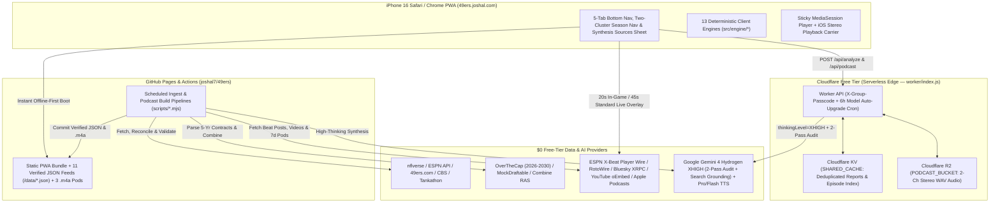

# Product Requirements Document (PRD): 49ers Faithful Briefing (`49ers.joshal.com`)

| Metadata | Details |
| :--- | :--- |
| **Product Name** | **49ers Faithful Briefing** (`49ers Faithful`) |
| **Production URL** | `https://49ers.joshal.com` (`CNAME` → `joshal7.github.io`) |
| **Repository** | `https://github.com/Joshal7/49ers` |
| **Target Platform** | Mobile Web PWA (iOS 18+ Safari `"Add to Home Screen"` on iPhone 16 / 16 Pro & Mobile Chrome) |
| **Target Audience** | Josh & ~24 die-hard, analytically minded 49ers-fan friends |
| **Operating Budget** | **Strictly \$0/month** (100% Free-Tier Infrastructure, Open NFL Datasets, & Free-Tier AI/TTS APIs) |
| **Design Philosophy** | High-signal football intelligence, zero clickbait/fluff, deep X's & O's, CBA salary cap mechanics, quantitative modeling, and **Accuracy-Over-Latency** generative synthesis |
| **Technical Reference** | See [`ARCHITECTURE.md`](./ARCHITECTURE.md) for module-level engineering specs and QA suites |

---

## 1. Executive Summary & Product Vision

**49ers Faithful Briefing (`49ers.joshal.com`)** is a private-group, mobile-first Progressive Web App (PWA) built for ~25 deeply knowledgeable San Francisco 49ers fans who want **verified facts, film/scheme takeaways, quantitative modeling, and CBA salary cap mechanics**—stripped of sensationalized clickbait and engagement-farming hot takes.

Modeled after the zero-cost GitHub Pages deployment pattern of `workouts.joshal.com`, the app combines:
1. **Automated Scheduled Ingestion & Sub-Minute Client Live Wire**: Continually pulls and normalizes 49ers roster data (`49ers.com`, ESPN, `nflverse`), play-by-play EPA/NextGen metrics, 5-year OverTheCap contract structures (`2026–2030`), 10-axis Combine spider-chart percentiles, official injury/practice logs, CBS/Tankathon trackers, 7-day flagship 49ers beat podcasts, and live Bluesky/ESPN feeds (`20s` in-game polling / `45s` standard polling).
2. **Accuracy-First On-Demand AI Deep Synthesis & Autopodcast Studio (Cloudflare Workers + KV + R2 + Gemini 4 Hydrogen XHIGH Free Tier)**: Allows any member of the friend group (authenticated via a shared group passcode) to trigger unhurried, 2-pass verified deep-dive analyses (`gemini-4-hydrogen` on `XHIGH` thinking + Google Search Grounding) or generate custom-duration (`2–20 min`), natural multi-speaker audio podcasts—which are immediately cached and shared across all ~25 friends.
3. **Season-Aware Dynamic Information Architecture**: Automatically adapts its dashboard modules to the NFL calendar and the 49ers' real-time status (`YEAR_ROUND`, `IN_SEASON`, `TRADE_WINDOW`, `PLAYOFF_PUSH`, `DRAFT_PREP`, `DRAFT_LIVE_UDFA`) while allowing each user to reorder high-level dashboard blocks via Up/Down controls or HTML5 Drag-and-Drop.

---

## 2. Target Audience, Editorial Charter & Quality Philosophy

### 2.1 Audience Profile
* **Users**: Josh + ~24 close friends.
* **Football IQ**: High. Users understand EPA/play, CPOE, success rate, DVOA concepts, Restructure vs. Post-June 1 cut mechanics, CBA Article 13 cap rollover, 11 vs. 21 personnel tendencies, Wide-9 defensive line alignments, Raheem Morris disguised split-safety rotations, and Kyle Shanahan / John Lynch roster-building archetypes. Inline **Jargon Quick-Bubble Popovers** (`src/engine/jargonGlossary.js`) provide instant tap-to-view definitions and 49ers context for 45+ advanced terms without cluttering the UI.
* **Primary Device Context**: iPhone 16 / 16 Pro running iOS Safari via a Home Screen Web App shortcut (`display: standalone`, title `49ers HQ`), plus Mobile & Desktop Chrome.

### 2.2 Strict "Faithful Editorial Charter" & Anti-Hallucination Guardrails
Every AI synthesis prompt, audio script builder, and feed classifier enforces the **Faithful Editorial Charter**:
1. **Ban Clickbait & Manufactured Drama**: Automatically filter out or down-rank speculative tabloid framing and off-topic league fantasy/betting roundups (`src/engine/antiFluffFilter.js`, `src/engine/linkIntegrity.js`). Never display internal meta-labels like `"War Room"`, `"clickbait cut"`, or `"No-Fluff Synthesis Engine"` in user-facing UI cards.
2. **Zero Retired/Departed Player Hallucinations (`src/engine/groundingValidator.js`)**:
   * Never attribute retired, cut, or departed former 49ers (e.g., Bryce Huff, Javon Hargrave, Charvarius Ward, Talanoa Hufanga, Aaron Banks, Leonard Floyd, Maliek Collins, Jordan Mason, Elijah Mitchell, Jauan Jennings, Arik Armstead, Chase Young, Randy Gregory) to the active 2026 49ers rotation.
   * Departed players may only be referenced in verified historical, 2026 dead-cap (e.g., Hargrave), opponent, or external trade-target contexts.
3. **Outbound Link Integrity, Direct Tweet Resolution & Zero Paywalls (`src/engine/linkIntegrity.js`, `src/engine/beatAttributionEngine.js`)**:
   * Every external link (`2,000+` across `/data/*.json`) must use `https://`, open safely (`target="_blank" rel="noopener noreferrer"`), strip tracking params (`utm_*`), block opaque shorteners/wrappers (`dlvr.it`, `bit.ly`, `news.google.com/rss/articles`) and paywalled/dead domains (`nytimes.com/athletic`, `theathletic.com`, `sfchronicle.com`, `mercurynews.com`, `pff.com/nfl/players/`, `espn.com/nfl/insider/`), and resolve tweets directly to original `x.com` / `bsky.app` posts (never ESPN player profile pages).
   * Player links use a multi-signal **Player Identity Resolver** that defeats upstream `nflverse` retired homonym collisions (e.g., 1978 NYG WR James Thompson `ThomJa01` vs. active 2026 49ers DT James Thompson Jr. `ThomJa06`) and never conflates ESPN IDs with OverTheCap IDs.

### 2.3 Quality vs. Speed Decision Philosophy
* **Push for Accuracy & Studio Quality Over Speed (`accuracy_over_latency`)**: On-demand Deep Analysis (`~20–40s`) and Autopodcast generation (`~30–130s`) use `gemini-4-hydrogen` on `XHIGH` Thinking (`thinkingLevel: "XHIGH"`) with a **2-pass internal self-audit** and Studio Pro TTS cascade (`gemini-2.5-pro-preview-tts` → `gemini-2.5-flash-preview-tts`). Concise pre-click wait hints (`[data-est-wait-preview]`, without verbose internal model-version clutter) and a live active job banner (`[data-job-progress="active"]`) keep wait times transparent, while Cloudflare KV/R2 deduplication gives the other ~24 friends `<50ms` instant reads.
* **Push for Sub-Second / Sub-Minute Speed**: App boot (`<300ms` via Service Worker `CacheStorage` `49ers-faithful-v28`), lazy per-tab rendering, 5-year cap moves (`<5ms`), 10,000-run Monte Carlo re-simulations (`<150ms`), and live X-Beat/Bluesky/ESPN breaking injury polling (`20s` in-game / `45s` standard) execute with sub-second / sub-minute responsiveness.

---

## 3. System Architecture (\$0/Month Hybrid Stack)

---

## 4. Seasonal & Temporal State Machine (`src/engine/seasonStateMachine.js`)

The app dynamically computes active modules based on the current date, the NFL schedule, and the 49ers' live season status:

| Phase ID | Trigger Window | Active Dashboard & Season Modules | Auto-Retirement Behavior |
| :--- | :--- | :--- | :--- |
| **`YEAR_ROUND`** | 365 days/year | **1. Team News & Beat Synthesis** (`news_briefs`) **2. Schedule & Matchups** (`schedule_overview`) **3. Roster & Depth Chart** (`roster_depth`) **4. 5-Year Salary Cap & GM Simulator** (`salary_cap`) **5. Audio & AI Studio** (`autopodcast_ai`) | Always visible on Dashboard & Bottom Nav. |
| **`IN_SEASON`** | NFL Kickoff Week (early Sept) → Moment 49ers season ends | **6. Upcoming Matchup** (`upcoming_matchup`) **7. Team Health & IR Priors** (`team_health`) **8. Team Stats & Rankings** (`team_stats`) | Moves to Seasonal Vault once 49ers season concludes. |
| **`TRADE_WINDOW`** | **Oct 1 (00:00 PT) → NFL Trade Deadline** (`2026-11-10T13:00:00-08:00`) | **9. Trade Window** (`trade_deadline`: Recent `<=30d` Acquisitions, Purchasing Power, Needs, Targets, Pitfalls) | Retires 1 minute after the Trade Deadline to the Seasonal Vault. Completed trades `>30 days` old live in the Archive Vault year-round. |
| **`PLAYOFF_PUSH`** | **Final 5 Weeks of Regular Season (`Week >= 14`)** *(if not mathematically eliminated)* | **10. Playoff Picture & Seeding Simulator** (`playoff_picture`: 10k Monte Carlo, Seed Paths, Interactive Rooting Guide) | Accessible anytime in `Game & Season → Playoffs` or Seasonal Vault. |
| **`DRAFT_PREP`** | **Moment 49ers are eliminated (or post-Super Bowl) → Start of NFL Draft Round 1** | **11. 2027 Draft Prep & Combine** (`draft_prep`: 6-Pick Tankathon Inventory, Needs, Consensus Mocks, Fit Scores, Combine RAS) | Accessible anytime in `Game & Season → Draft` or Seasonal Vault. |
| **`DRAFT_LIVE_UDFA`** | **Day 1 of NFL Draft → Mid-May Post-UDFA Window** | **12. 2026 Draft Class & UDFA Recap** (`draft_live_udfa`: Pick Value vs Board, Inline Spider Charts, UDFA Guarantees) | Accessible anytime in `Game & Season → Draft Recap` or Seasonal Vault. |

### Default 12-Block Home Priority Order
`news_briefs` (1) → `upcoming_matchup` (2) → `team_health` (3) → `schedule_overview` (4) → `trade_deadline` (5) → `playoff_picture` (6) → `draft_prep` (7) → `draft_live_udfa` (8) → `team_stats` (9) → `roster_depth` (10) → `salary_cap` (11) → `autopodcast_ai` (12).

---

## 5. UX, Navigation & Responsive Geometry Specifications

### 5.1 Visual Identity: `"Levi's Night Game"` Dark & `"'94 Throwback"` Light Themes
* **Dark Theme (Default)**: Deep Obsidian (`#0B0D10`), Elevated Slate (`#14181F`), 49ers Scarlet (`#AA0000` / `#D11919`), Metallic Saloon Gold (`#B3995D` / `#D4BC7E`).
* **Light Theme Toggle (`Settings`)**: `"'94 Throwback White & Gold"` (`#F7F5F0` background, `#FFFFFF` cards) for bright stadium/daylight viewing.
* **Typography & Alignment**: `Inter` / `-apple-system` for editorial prose; `JetBrains Mono` / `SF Mono` with `font-variant-numeric: tabular-nums` for all cap tables, EPA figures, and percentages.

### 5.2 Mobile Navigation Architecture
1. **Sticky 5-Tab Bottom Navigation Bar (`index.html`)**:
   * Ordered left-to-right for optimal in-season workflow:
     1. **`Home`** (`data-nav-tab="home"`)
     2. **`News & Film`** (`data-nav-tab="news"`)
     3. **`Game & Season`** (`data-nav-tab="season"`)
     4. **`Roster & Cap`** (`data-nav-tab="roster"`)
     5. **`Audio & AI`** (`data-nav-tab="audio"`)
2. **Two-Cluster `Game & Season` Sub-Navigation (`src/views/seasonMatchupView.js`)**:
   * Replaces single-row horizontal scrolling with two stacked 4-button cluster bars (`0px` horizontal scroll across all `360px–430px` portrait viewports):
     * **Cluster Bar 1 (Weekly & In-Season)**: `Matchup` | `Health` | `Schedule` | `Stats`
     * **Cluster Bar 2 (Temporal & Horizon)**: `Trade` (with live pulsing indicator dot during active window) | `Playoffs` | `Draft` | `Draft Recap`
   * **Exclusive Trade Window Banner Placement**: `#phaseBanner` (`Active NFL Trade Window`) is hidden on all tabs and sub-tabs **except** `Game & Season → Trade`, where it renders directly below `.season-subnav-card` and above `.card.temporal-highlight`.

---

## 6. Detailed Functional Requirements by Module

### Section 1: Roster Explorer, 5-Tab Player Dossiers & Dual Depth Chart
* **Roster Explorer (`src/views/rosterCapView.js`)**:
  * Full 88-player roster (53 Active, IR/Reserve, Practice Squad), sorted by `Roster Number` (`jersey` ascending) by default.
  * **Streamlined Sort Control**: Single Dropdown (`#rosterSortSelect`: `Roster Number`, `First Name`, `Last Name`, `2026 Cap Hit`, `Snap Share %`, `Play Likelihood`, `Athletic RAS`, `Age`) paired with an adjacent Up/Down Arrow direction toggle button (`#rosterSortDirBtn`, `data-sort-dir="asc|desc"`). Zero cluttered sort pills.
  * **Two Filter Rows**: `Unit Filter` (`All`, `Active 53`, `Offense`, `Defense`, `Special Teams`, `IR / Reserve`, `Practice Squad`) and `Position Group Filter` (`ALL`, `QB`, `RB`, `WR`, `TE`, `OL`, `DL`, `LB`, `DB`).
  * **Resilient Search**: Preserves input focus and cursor position across keystrokes, supports `#0` jersey lookup (`Renardo Green`), and normalizes straight, iOS curly (`’`), and omitted apostrophes (`De'Zhaun Stribling`).
* **5-Tab Player Dossier Bottom Sheet (`src/views/playerSheetView.js`)**:
  1. **`Overview`**: Bio, verified outbound links (`ESPN`, `OverTheCap`, `Pro-Football-Reference`), live injury/play-probability badge, and **Last 7 Days Player Mentions** (combining salient beat tweets with full untruncated text `<=320` chars + beat articles, 100% author attribution, and live breaking injury priority).
  2. **`Stats & EPA`**: `2026 Season` vs `Career` toggle, standard stats, `nflverse` EPA/CPOE/Success Rate/WOPR, NextGen Stats, PFR Advanced metrics, and non-box-score OL snap/efficiency handling.
  3. **`Spider Chart`**: 10-axis MockDraftable/Combine SVG radar chart (`1st–99th` positional percentiles) + top 3 historical NFL athletic comparables.
  4. **`Contract`**: Multi-year OverTheCap breakdown + interactive 6-scenario transaction calculator (`Pre-June 1 Cut`, `Post-June 1 Cut`, `Pre-June 1 Trade`, `Post-June 1 Trade`, `Restructure`, `Extension`).
  5. **`Health & Priors`**: Wed/Thu/Fri practice participation, toughness/availability prior, and reserve list eligibility (`Season-Ending IR` / `Ineligible` / `Out for Season` vs. active 21-day return windows).
* **Dual-Mode Depth Chart**: 1-tap toggle between `Projected Week X Active` and `Baseline Hierarchy`, ordered `Offense`, `Defense`, `Special Teams`.

### Section 2: Team News, Sub-Minute Breaking Wire, Synthesis Sources & Jargon Popovers
* **48-Source X-First Reporter Registry (`data/reporters.json`)**: Auto-ranked every 14 days (`npm run update-reporters`) with guardrails preventing podium subjects (`Kyle Shanahan`, `John Lynch`) or cross-reporter defaults from hijacking journalist authorship.
* **Tab Ordering & Clickable `XX reports` Synthesis Sources (`src/views/newsView.js`, `src/views/homeView.js`)**:
  * `News & Film` orders tabs left-to-right as **`Wire & Video`** (`raw`, default active tab) followed by **`Synthesis Briefs`** (`clustered`), while `Home` keeps Synthesis Briefs above the live Beat Tweet Wire.
  * Every AI synthesis card's `XX reports` pill (`[data-action="open-synthesis-sources"]`) opens a slide-up **`Reports Used (XX)`** bottom sheet listing all underlying beat tweets and articles with clickable external links.
* **Streamlined Single-Author Tweet Cards & Direct Links**:
  * Displays who tweeted (clickable author link) and relative age (`14m ago`) **once** per card, strips redundant inline `"per [Author]"` boilerplate, collapses duplicate injury updates into expandable `+N confirming reports`, and links tweets directly to `x.com` / `bsky.app` (never ESPN player bio pages).
* **Sub-Minute Live Breaking, In-Game & 48h Post-Game Salience (`src/services/dataService.js`, `src/engine/breakingClassifier.js`)**:
  * Polls 5 live channels (ESPN 24/7 X-Beat Player Wire, RotoWire NFL RSS, Official 49ers/ESPN Transactions, Bluesky AT Protocol, and ESPN Live Summary) every **20 seconds during active 49ers game windows** and every **45 seconds** otherwise.
  * Elevates live in-game updates (`LIVE INJURY UPDATE`) while demoting stale pre-game inactive blurbs after kickoff, prioritizes meaningful new injury updates for **48 hours post-game** (deduplicating repetitive blurbs by milestone bucket), and runs `balanceFeedTopSalience` so credible trade rumors, player/owner legal news, and 1-on-1 player interviews are never crowded out.
* **Verified Video Embeds**: Checks YouTube oEmbed status for every video (`embeddable: true | false`); embeddable clips mount inline with `playsinline=1` and `referrerpolicy="strict-origin-when-cross-origin"`, while DRM-blocked videos render clean external thumbnail cards (`a.video-external-card`).

### Section 3: 5-Year Salary Cap Analysis & Armchair GM Simulator (`2026–2030`)
* **5-Year Rolling OverTheCap Horizon (`#capHorizonSummaryCard` & `#capSimulatorCard`)**:
  * Interactive year tabs (`2026`, `2027`, `2028`, `2029`, `2030`) sync both the team cap horizon summary (with collapsible Front Office Blueprint) and the 53-player simulator table.
  * **9-Column Simulator Table**: `Player`, `Base Salary`, `Prorated Bonuses`, `Current Yr Bonuses`, `Guaranteed Salary`, `Cap Number`, `Roster Move`, `Dead Money`, `Cap Savings`. Fits all 9 columns without horizontal scrolling in iPhone 16 / 16 Pro landscape (`852x393` & `874x402`).
  * Defaults `Dead Money` and `Cap Savings` to `$0` / `$0` when `Roster Move === 'Keep / No Move'`, matches OverTheCap penny-for-penny on active moves, and enforces the NFL CBA 2-player Post-June 1 limit and Top-53 replacement rules.

### Section 4: Game-Day Inactives (`[T-90m, Final)`), Frozen Column 1 Health Tables, Opponent Parity & Temporal Modules
* **Game-Day Inactives & Starting-Collapsed Active Roster (`src/engine/gameDayRosterEngine.js`)**:
  * From **90 minutes before kickoff until game conclusion (`[T-90m, Final)`)**, renders a top-of-page **Game-Day Inactives & Active Roster** block for the **49ers** (top of `Team Health`) and the **Opposing Team** (above `Practice Participation & Modeled Play Likelihood` in `Matchup`), robust to slight T-90m posting delays (`Official Inactives Pending` → `Official Inactives`).
  * Lists declared Inactive players alongside a **starting-collapsed `
` Active Roster (~46–48 players)** organized `Offense → Defense → Special Teams`, resolves pre-game `Questionable` players to `In (Active)` (`99%`) or `Out (Inactive)` (`0%`, preserving rare `Active • GTD`), and automatically disappears once the game is `Final`.
* **Frozen Sticky Column 1, Narrow Matchup Table & Immediate `Week N+1` Rollover**:
  * Both 49ers `Team Health` and `Matchup` practice/play-likelihood tables freeze **Column 1 (`Player`)** via `position: sticky; left: 0` with solid dark/light surface backgrounds during horizontal scrolling; the Opponent table matches the compact narrow width of 49ers Health while displaying player position & team importance (`Starter · XX% snaps` / `Key Rotation`).
  * Immediately upon game completion (`Final`), `Matchup` and `Team Health` roll forward to **Upcoming `Week N+1`**, clearing `W / T / F` practice columns to `—`, pruning healthy pre-game cleared players, and recalculating `Week N+1` play likelihood.
* **Team Health & Season-Ending IR Reconciliation**:
  * Reconciles `49ers.com` Roster/Injury HTML (with current-opponent match guard), CBS Injuries, and ESPN transactions.
  * Distinguishes `Season-Ending IR` (`Out for Season`), `IR — 21-Day Window Open` (`Est. Week X`), `TBD (21d Window Not Open)`, `Reserve / PUP`, and `Reserve / Left Squad`.
* **Single-Screen Portrait Team Stats (`#teamStatsRankingsCard`)**:
  * Renders 4 columns (`Metric`, `49ers`, `Rank`, `NFL Avg`) across all 11 NFL rankings so the entire table fits on a single portrait screen above `.bottom-nav` with `0px` horizontal scroll.
* **Trade Window (30-Day Cutoff) & Calibrated Playoff Monte Carlo**:
  * `Trade Window` partitions completed moves by a 30-day recency window (`<=30d` in Trade Window; `>30d` in Archive Vault), models 3-tier CBA base-salary purchasing power, and flags trade pitfalls (e.g., age-37 Cameron Jordan, extended Michael Mayer).
  * `Playoff Picture` runs a calibrated Empirical-Bayes 10,000-iteration Monte Carlo simulation honoring NFL 2-club and 3+-club tiebreakers (including 3-club complete H2H sweep & Step-1 restart rules).

### Section 5: Audio & AI Studio (`49ers Podcasts 7d`, `Autopodcast Studio`, `Deep Analysis`) & Settings
* **49ers Podcasts (7d) (`data/beat-podcasts.json`)**:
  * Aggregates all episodes published in the last 7 days across the 6 flagship 49ers beat podcasts (*The Gold Standard*, *49ers Talk*, *49ers +/-*, *Dieter and Hutch*, *Locked On 49ers*, *Lombardi Lounge*) with episode titles, summaries, `By Date` vs `By Podcast` views, show filter pills, and native mobile deep links (`podcasts://` on iOS/iPadOS, `intent://...#Intent;scheme=pcast` on Android).
* **Autopodcast Studio, Settings Controls & iOS Built-In Speaker Unlock**:
  * Includes 3 pre-generated 44.1 kHz 96kbps AAC (`.m4a`) episodes mastered with a 7-stage broadcast DSP chain, plus on-demand custom podcast generation (`2–20 min` touch-safe slider); `Host Format` (`Two-Host` vs `Solo Briefing`) and `Default Podcast Length` live cleanly inside top-right **Settings**.
  * `PodcastAudioController` unlocks iOS Safari / Home Screen PWA built-in phone speaker playback (even when the hardware Ring/Silent switch is ON without AirPods) via `navigator.audioSession.type = 'playback'`, Web Audio `AudioContext` resume, and a looping 2-channel Stereo 16-bit PCM WAV carrier (`buildSilentPlaybackCarrierWavDataUri`) with `±2 LSB` (`-84 dBFS`) dither.

---

## 7. Automated Quality Assurance (`npm test`)

All requirements in this PRD are continuously verified by three automated test suites:
1. **`tests/unit-engines-qa.mjs`**: Verifies all 13 deterministic engines, `[T-90m, Final)` game-day roster & `Week N+1` rollover models, 5-year OverTheCap math, Season-Ending IR & `49ers.com` parsers, calibrated Monte Carlo tiebreakers, anti-hallucination scrubbing, `2,000+` HTTPS non-paywalled URLs, 7-day beat podcasts, Edge Worker 2-pass `gemini-4-hydrogen` `XHIGH` synthesis, and 44.1 kHz broadcast DSP / stereo carrier generation.
2. **`tests/holistic-qa-regressions.mjs`**: Verifies `2027–2030+` season rollovers, post-Week-18 elimination states, 17-game standings conservation, clause-scoped game-day tweet signals, outbound link/shortener scrubbing, journalist vs. podium-coach attribution, and early-week injury rollover invariants.
3. **`tests/e2e-mobile-qa.mjs` (`npm run test:e2e`)**: Drives Headless Chrome via CDP across 8 mobile/tablet/desktop viewports (`320x640` through `1280x900`) verifying every interactive workflow, sticky Column 1 dark/light opaque backgrounds, clickable `XX reports` synthesis sources sheet, `0px` horizontal overflow, portrait/landscape table geometry, and `0` console/page/network errors.
